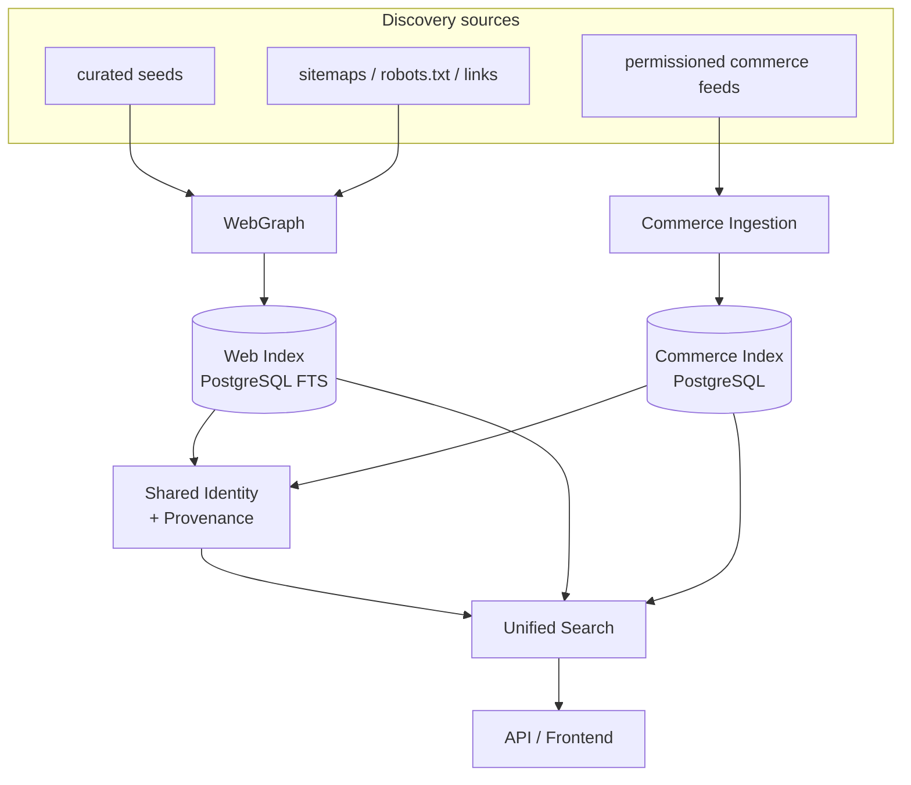

# 00 — Executive Summary

**Project:** IntentForge — Web Discovery & Commerce Intelligence Architecture
**Research date:** 10 November 2026
**Status:** For founder review. **Nothing here is approved architecture until signed off.**
**Package contents:** 12 documents, `SOURCES.md`, Mermaid diagrams, SQL migrations, API contracts.

---

## 1. What We Learned

### 1.1 The search-engine research confirms a clear split

Modern search engines separate **discovery**, **crawling**, **indexing**, and **serving** into distinct systems with distinct scaling properties. Google documents URL discovery as link-following, sitemaps, and redirects; Bing, DuckDuckGo, and Brave each combine a first-party index with external providers. The important finding for a small team: **no independent engine attempts open-web coverage at Google scale.** Every credible independent engine either curates or partners.

**Implication:** IntentForge should build a *curated, policy-governed* index, not an open-web crawler.

### 1.2 The existing codebase is not on the locked foundation

Verified by reading the repository:

| Locked decision | Reality |
|---|---|
| PostgreSQL primary database | **Not used anywhere.** No SQLx dependency in any service. |
| SQLx for data access | Not present. |
| Modular monolith | Partially true; services exist but share no data layer. |
| Web discovery: controlled | The crawler has **no robots.txt, no sitemap, no politeness, no conditional requests, no crawl budget**, and uses a hardcoded browser User-Agent. |

The crawler is 1,793 lines with `/crawl`, `/enqueue`, `/queue/status`. The indexer is 905 lines using **Tantivy** (an embedded library index) plus Sled. Neither writes to PostgreSQL.

**Implication:** WebGraph is a genuine new subsystem, but it must absorb the existing crawler and indexer rather than replace them outright.

### 1.3 The commerce research produced the most important finding of the entire package

> **Almost every commerce data provider forbids the exact thing IntentForge wants to do: build a standing product database, redistribute product data, or aggregate catalogues across merchants.**

Three load-bearing clauses, quoted verbatim in `03`:

| Provider | Clause |
|---|---|
| **Amazon** | Operating Agreement §11(12): *"You will not, without our express prior written approval, sell, resell, redistribute, sublicense, or transfer … any Product Advertising Content … or any application that … incorporates or displays Product Advertising Content."* |
| **Shopify** | API Terms §3.14: *"not use the Shopify API to conduct any systematic or automated data collection activities … or to build any commerce or product index"*; Catalog guidelines: *"Don't aggregate, rehost, redistribute, resell, syndicate, or bulk export Catalog results to third parties."* |
| **eBay** | API License Agreement §4.4: *"Commercialize (that is, sell, rent, trade or lease), copy or store the eBay Content, other than for the intermediate purposes allowed by this Agreement"* |

**This is a strategic finding, not a technical one.** The original mission brief assumed a hybrid catalogue combining merchant APIs, feeds, affiliate networks, and permitted extraction. The evidence shows that most of those sources **do not permit** the assumed use. The architecture must therefore be designed around the *actual* permission landscape, not the hoped-for one.

Three viable paths remain:
1. **Live per-request proxying** — no standing index; fetch and display within a session.
2. **Link-only monetisation** — deep links and affiliate redirects; no product data stored.
3. **Permissioned feeds** — merchant consent, partner agreements, or feeds the operator is authorised to manage.

### 1.4 There is no keyless structured-price engine available

SearXNG ships exactly two shopping-categorised engines in this build: `ebay` and `geizhals`. Both are disabled by default; both return **HTTP 403** from a datacenter/VPN egress. The gateway's existing `categories=shopping` fan-out has been silently falling back to general web results because the category was never registered.

### 1.5 Security posture needs work before any crawl

The current crawler has no SSRF protection, no URL validation, no size limits, and no network isolation. Any crawl that begins before these controls exist is a meaningful risk.

---

## 2. Recommended Architecture

**Five architectural principles:**

1. **PostgreSQL is the system of record.** Any inverted index is a projection, never the truth.
2. **WebGraph and Commerce stay separate**, meeting only through shared identity and provenance services at read time.
3. **Policy is code.** Permissions are rows in a table evaluated by a testable engine, not conventions.
4. **Ranking is structurally independent of commission.** The ranking path receives no commercial field, and a test enforces it.
5. **Curated scope.** A small, reviewed domain list rather than open-web crawling.

---

## 3. Major Decisions

| # | Decision | Recommendation |
|---|---|---|
| D1 | Crawl scope | **Curated domains** (50-200 initially) |
| D2 | Headless rendering | **Defer** |
| D3 | Search engine | **PostgreSQL FTS first**, Tantivy only if measured need |
| D4 | Retention | Short defaults; per-content-type justification |
| D5 | User submissions | **Defer** |
| D6 | Price display from crawled pages | **Prohibit** without explicit permission |
| D7 | Commerce sourcing | **Global-first**, then India as access is verified |
| D8 | Revenue | **Affiliate-first** with structural ranking independence |
| D9 | Identity thresholds | **Conservative**; never auto-merge on weak signals |
| D10 | Query log retention | 90 days, salted hashes |
| D11 | Takedown SLA | 24 hours for suppression |
| D12 | Crawl egress | VPN + Tor with per-domain routing |

Full reasoning, alternatives, and consequences are in `10_OPEN_DECISIONS_AND_RISKS.md`.

---

## 4. Biggest Risks

| Risk | Impact | Mitigation |
|---|---|---|
| **Commerce sources forbid the assumed use** | **Severe — threatens the commerce thesis** | Redesign around permissioned feeds, live proxying, or link-only models; legal review |
| Legal claim over extraction or redistribution | Severe | Permissions model; prohibit by default; counsel review |
| Crawler blocked or IP banned | Medium | Strict budgets, honest User-Agent, Tor fallback |
| PostgreSQL FTS insufficient for ranking | Medium | Measure in Phase 0; Tantivy fallback |
| Identity over-merging destroys trust | Severe | Conservative thresholds; review queue |
| Scope creep into open-web crawling | High | Policy-enforced curated scope |
| Ranking contaminated by commercial pressure | Severe | Structural exclusion + test enforcement |
| Building infrastructure before demonstrating value | High | MVP boundary; phase gates |

---

## 5. MVP Recommendation

> **A curated set of ~50-200 domains, crawled politely with full policy enforcement, indexed in PostgreSQL, searchable through a public API with provenance on every result — plus ONE commerce connector operating under an explicit permission, feeding a product search that aggregates at least two merchants for a handful of products.**

**Why this boundary:**
- It exercises every critical path: discovery, policy, crawl, index, search, ingestion, identity, aggregation.
- It is small enough to reason about and to crawl without being blocked.
- It produces something a user can actually try.
- It avoids the two classic traps: scale before value, and product database before search.

**Explicitly not in the MVP:**
- Headless rendering.
- User-submitted URLs.
- More than a handful of commerce connectors.
- Open-web (non-curated) crawling.
- Any commerce source whose terms have not been reviewed.

---

## 6. The 10 Most Important Decisions for Founder Approval

1. **D1 — Curated crawl scope**, and the process for admitting domains.
2. **D2 — Deferring headless rendering** past the MVP.
3. **D3 — PostgreSQL FTS as the primary search engine**, validated in Phase 0.
4. **D4 — Retention periods** per content type.
5. **D5 — Deferring user-submitted URLs.**
6. **D6 — Prohibiting price display from crawled pages** without explicit permission *(also requires legal review)*.
7. **D7 — Global-first commerce sourcing**, adding India as access is verified.
8. **D8 — Affiliate-first revenue** with structural ranking independence.
9. **D10 — 90-day query log retention**, salted hashes by default.
10. **D11 — 24-hour takedown suppression SLA.**

---

## 7. Recommended First Milestone

**Milestone M1 — end of Phase 1 + first half of Phase 2:**

> A running system that crawls **20 curated domains** politely with full policy enforcement, stores everything in PostgreSQL with provenance, and serves a public web search API whose results are explainable.

**Success criteria:**
- Crawl success rate ≥ 0.90
- Politeness compliance 1.00
- Zero SSRF bypasses
- Search p95 ≤ 800 ms on the benchmark corpus
- Every result carries provenance

**Why start here:** it proves the entire critical path without commerce complexity, produces real data to calibrate the benchmarks, and gives the founder something usable to evaluate before the harder commerce questions are settled.

---

## 8. What Should Not Be Built Yet

| Item | Why deferred |
|---|---|
| Headless rendering | Cost and legal exposure; most MVP content is static |
| User-submitted URLs | Abuse vector; needs identity and review tooling |
| Open-web crawling | Legal exposure, crawl traps, unbounded cost |
| More than a few commerce connectors | Each requires legal review; access is unproven |
| A second search engine (Tantivy) | Adds a consistency obligation without a measured need |
| Mobile applications | API-first; clients follow value |

---

## 9. What Could Block the Project

1. **Commerce licensing.** If no provider grants permission for the intended use, the commerce thesis must be redesigned around live proxying or link-only models. This is the single largest strategic risk.
2. **Legal review availability.** Decisions D6 and D7 cannot proceed without counsel.
3. **Founder review cadence.** Ten decisions need approval; the timeline depends on turnaround.
4. **Crawl egress quality.** If both VPN and Tor are blocked by target sites, coverage suffers.
5. **Team capacity.** Phase estimates assume parallel agent delegation; review time does not compress.

---

## 10. How to Read This Package

| Document | For |
|---|---|
| `01_SEARCH_ENGINE_RESEARCH.md` | Evidence on how Google, Bing, DuckDuckGo, Brave operate |
| `02_WEBGRAPH_ARCHITECTURE.md` | Complete WebGraph design, modules, policies |
| `03_COMMERCE_DATA_RESEARCH.md` | Provider-by-provider evidence, clauses, permissions |
| `04_COMMERCE_ARCHITECTURE.md` | Canonical catalogue, identity resolution, provenance |
| `05_UNIFIED_SEARCH_ARCHITECTURE.md` | Query understanding, ranking, explanations |
| `06_DATABASE_AND_API_SPEC.md` | ER diagram, schema, migrations, API contracts |
| `07_SECURITY_PRIVACY_AND_COMPLIANCE.md` | Threat model, legality framework, privacy |
| `08_BENCHMARK_PLAN.md` | Metrics, datasets, thresholds, failure injection |
| `09_IMPLEMENTATION_ROADMAP.md` | Phases, dependencies, agent work packages |
| `10_OPEN_DECISIONS_AND_RISKS.md` | Decision register, risk register, approvals needed |
| `SOURCES.md` | Bibliography with URLs and access dates |

**Evidence convention used throughout:** **[CONFIRMED]** = primary source states it · **[INFERRED]** = well-supported engineering reasoning · **[UNKNOWN]** = undisclosed or unverified.

---

*This summary is a proposal. Nothing in this package is approved architecture until the founder signs off on the decisions in `10_OPEN_DECISIONS_AND_RISKS.md`.*
