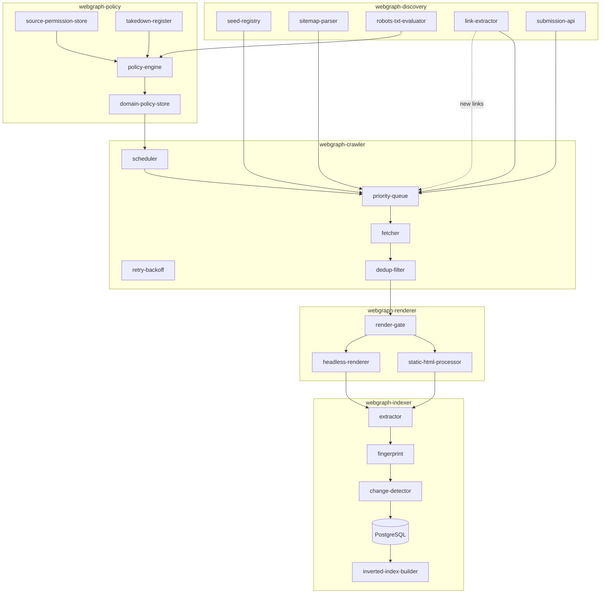
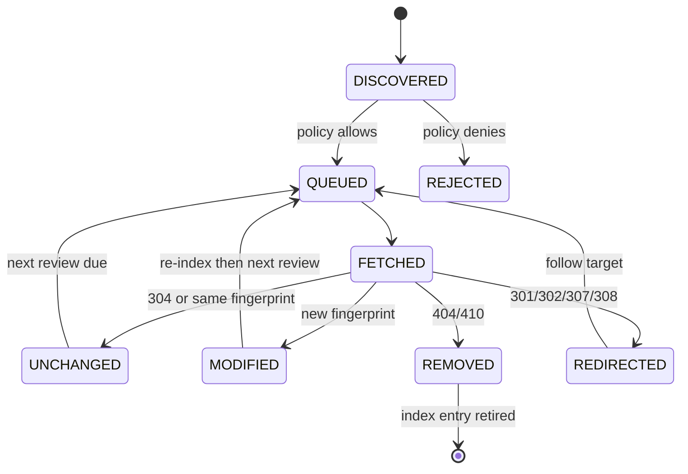

# 02 — WebGraph Architecture

**Status:** Proposed architecture for founder review.
**Companion documents:** `00_EXECUTIVE_SUMMARY.md`, `01_SEARCH_ENGINE_RESEARCH.md`, `04_COMMERCE_ARCHITECTURE.md`, `06_DATABASE_AND_API_SPEC.md`.
**Scope:** Discovery, crawling, processing, and indexing of permitted web pages. Commerce is explicitly out of scope here (see `04`).

---

## 1. Design Goals and Non-Goals

### Goals

| # | Goal | Why it matters |
|---|---|---|
| G1 | Discover and index permitted web pages without violating site policy | Legal and ethical baseline; see `07` |
| G2 | Be honest about what is indexed and why | Users can understand result provenance (Mission D) |
| G3 | Bounded, measurable resource consumption | Small team, modest hardware |
| G4 | Conceptually separate from the Commerce Index | Prevents the two systems collapsing into one |
| G5 | Every module independently runnable and testable | AI-agent delegation (Phase 8) |
| G6 | No user tracking, ever | Product principle (Mission G) |

### Non-Ggoaps (explicitly deferred)

- **Not** building a Google-scale web index. The realistic target is a **curated, policy-governed, domain-scoped** index.
- **Not** rendering every page with JavaScript. Rendering is expensive and legally riskier; it is opt-in per domain (§5).
- **Not** redistributing full page content. WebGraph indexes *metadata and extracted facts*, not a mirror of the web.
- **Not** scraping behind authentication or bypassing technical protection measures.

---

## 2. Current State (as of November 2026)

Verified by reading the repository:

| Component | Reality today | Gap |
|---|---|---|
| `services/crawler` | Axum service, 1793 LOC. Endpoints: `/crawl`, `/enqueue`, `/queue/status`. Fetches with a hardcoded Chrome User-Agent. | No robots.txt handling, no sitemap parsing, no ETag/Last-Modified, no conditional requests, no crawl budget, no politeness delay, no domain-level policy. |
| `services/indexer` | Axum service, 905 LOC. Tantivy full-text index + Sled metadata store. Schema: `url`, `title`, `content`, `timestamp`, `currency`. | Tantivy is an embedded library index, not PostgreSQL. No content fingerprint, no change detection, no canonical handling, no language/geo metadata. |
| `services/gateway` | 26,816 LOC. Merges upstream SearXNG results with the local indexer. | Commerce enrichment is bolted onto `/search`; no catalogue abstraction. |
| PostgreSQL | **Not used anywhere.** No `sqlx`/diesel/sea-orm dependency in any service. | The locked decision to use PostgreSQL + SQLx is unimplemented. |

**Implication:** WebGraph is a genuine new subsystem, but it must **absorb** the existing crawler and indexer rather than replace them wholesale. Phase 1-2 of the roadmap handle that migration.

---

## 3. Guiding Architectural Principles

1. **PostgreSQL is the system of record.** Tantivy (or any inverted index) is a *projection* built from PostgreSQL, never the source of truth. This is what makes change detection, retention, and audit possible.
2. **Policy is code, not convention.** robots.txt decisions, crawl budgets, and permissions are stored in tables and evaluated by a module — not by ad-hoc checks scattered through the crawler.
3. **Every stored row carries provenance.** Who permitted this? When was it fetched? Under what policy version? Without this, takedown and audits are impossible.
4. **Fail closed.** If policy cannot be evaluated, do not crawl.
5. **Bounded by default.** Every queue has a cap; every fetch has a size limit and timeout; every domain has a budget.
6. **Separate "found" from "allowed" from "fetched" from "indexed".** These are four distinct states with different lifetimes and different owners.

---

## 4. Module Architecture

### 4.1 Module map



### 4.2 Module responsibilities and boundaries

#### `webgraph-discovery`

**Owns:** turning seeds and pages into candidate URLs.

| Sub-module | Responsibility | Key outputs |
|---|---|---|
| `seed-registry` | Curated starting points, grouped by trust tier and topic | `seed_url` rows |
| `sitemap-parser` | Fetch and parse `sitemap.xml` / `sitemap-index.xml` / `.gz`; respect `<lastmod>` | `discovered_url` rows with `source=sitemap` |
| `robots-txt-evaluator` | Fetch, parse (RFC 9309), cache with TTL, evaluate allow/disallow for a UA | `robots_rule` rows, `allowed: bool` |
| `link-extractor` | Extract links from HTML; resolve relative URLs; filter by scheme/host scope | `discovered_url` rows with `source=link` |
| `submission-api` | Accept merchant/user URL submissions with identity + attestation | `submission` rows |

**Boundary rule:** Discovery **never fetches page bodies** except for sitemaps and robots.txt. It does not decide policy.

#### `webgraph-policy`

**Owns:** every question of "are we allowed to do this?"

| Sub-module | Responsibility |
|---|---|
| `policy-engine` | Pure decision function: `(url, ua, action) -> Decision`. Deterministic and unit-testable. |
| `domain-policy-store` | Per-domain crawl budget, render permission, rate limit, and notes. |
| `source-permission-store` | Explicit grants/restrictions per source, with licence text and expiry. |
| `takedown-register` | Exclusion requests, with status and audit trail. |

**Boundary rule:** The policy engine returns a decision; it does not enforce it. Enforcement lives in the scheduler and fetcher. This keeps policy testable without a network.

#### `webgraph-crawler`

**Owns:** moving bytes from the network into the system, politely and bounded.

| Sub-module | Responsibility |
|---|---|
| `scheduler` | Picks the next URL by priority, subject to per-domain concurrency and budget. |
| `priority-queue` | PostgreSQL-backed queue (see `06`), not in-memory. Survives restarts. |
| `fetcher` | HTTP with conditional requests, redirects, timeouts, size caps. |
| `retry-backoff` | Exponential backoff with jitter; respects `Retry-After`. |
| `dedup-filter` | Exact-URL and content-fingerprint dedup before fetch. |

**Boundary rule:** The crawler does not parse content beyond what is needed for conditional requests and content-type detection. Extraction belongs to the indexer.

#### `webgraph-renderer`

**Owns:** the decision and machinery for JavaScript-rendered pages.

| Sub-module | Responsibility |
|---|---|
| `static-html-processor` | The default path. Parses static HTML, extracts metadata and structured data. |
| `headless-renderer` | Opt-in Chromium via Playwright for domains explicitly permitted to render. |
| `render-gate` | Decides static vs. rendered per domain, based on policy and observed need. |

**Boundary rule:** Rendering is **never** the default. It requires (a) an explicit per-domain grant, and (b) a measured failure of the static path. See §5.

#### `webgraph-indexer`

**Owns:** turning a fetched document into searchable, provenance-bearing records.

| Sub-module | Responsibility |
|---|---|
| `extractor` | Title, description, headings, main content, language, canonical, links, structured data. |
| `fingerprint` | Content hash (normalized) for dedup and change detection. |
| `change-detector` | Compares fingerprints and metadata; classifies unchanged / modified / removed / redirected. |
| `inverted-index-builder` | Projects PostgreSQL rows into the search index (Tantivy or PostgreSQL FTS). |

**Boundary rule:** The indexer never mutates policy or queue state.

---

## 5. URL Discovery Design

### 5.1 Seed management

Seeds are **curated**, not guessed. Each seed has:

- `seed_url`, `trust_tier` (editorial / partner / public-directory / user-submitted)
- `topic_tags`
- `crawl_policy_override` (nullable)
- `added_by`, `added_at`, `review_status`

**Rationale:** A small independent engine cannot crawl the whole web. Curated seeds with explicit trust tiers are the only defensible way to bound scope and demonstrate value early.

### 5.2 Sitemap discovery

- Check `/sitemap.xml`, `/sitemap-index.xml`, `/sitemap.txt`, `/sitemap.xml.gz` and any URL in `robots.txt`'s `Sitemap:` directive.
- Parse `<loc>`, `<lastmod>`, `<changefreq>`, `<priority>`.
- **Do not trust `changefreq`/`priority`** as anything more than a weak hint; they are frequently inaccurate.
- Respect `lastmod` as a *conditional-request* hint, not a guarantee.

### 5.3 robots.txt

- Implemented per **RFC 9309** (Robots Exclusion Protocol, September 2022).
- Fetch with a dedicated User-Agent token; cache with a TTL (recommended 24h) and re-fetch on `4xx`.
- Group matching by `User-agent`, longest-match rule, `Allow` beats `Disallow` on equal length.
- Honour `Crawl-delay` if present.
- **Failure mode:** if robots.txt cannot be fetched, treat as **disallow all** for that domain until it can be retrieved. This is the conservative choice and matches the policy-engine principle of failing closed.

### 5.4 Link extraction

- Extract from `<a href>`, `<link>`, `<area>`, and (for sitemaps) `<loc>`.
- Resolve against the document URL (RFC 3986).
- Filter: `http`/`https` only; reject credentials in URL; reject non-standard ports unless explicitly allowed.
- Apply **scope rules**: same registrable domain by default; configurable per seed to include subdomains or specific paths.
- Reject URLs that trip SSRF defences (§9 of `07`).

### 5.5 Merchant and user submissions

- Submissions create a `submission` row in a **quarantine** state.
- A submission does **not** grant crawl permission by itself; it still passes the policy engine.
- Submitter identity is recorded for audit. User submissions require a captcha or equivalent abuse control.

---

## 6. Crawling Design

### 6.1 Politeness

| Mechanism | Proposed default | Configurable per domain |
|---|---|---|
| Concurrent connections per domain | 1 | yes |
| Minimum delay between requests | 1000 ms | yes, from `Crawl-delay` |
| Daily crawl budget per domain | 500 pages | yes |
| Respect `Retry-After` | always | no |
| Respect `Connection: close` | yes | no |

**Token-bucket per domain** is the recommended implementation: it smooths bursts and is easy to reason about.

### 6.2 Conditional requests and change detection

Every fetch sends:

```
If-None-Match: <etag>
If-Modified-Since: <last_modified>
```

- `304 Not Modified` → update `last_checked`, keep existing content, **do not** re-index.
- `200 OK` → compute fingerprint; compare with stored fingerprint.
- `301/302/307/308` → record the redirect chain, update canonical target, re-queue target.
- `404/410` → mark `removed`, schedule for index removal.

### 6.3 Crawl priority

Priority is a **computed score**, not a queue insertion order:

```
priority = w1*page_rank_proxy
         + w2*freshness_urgency
         + w3*observed_change_rate
         + w4*trust_tier
         + w5*user_demand_signal
```

- `page_rank_proxy`: internal link-graph centrality computed over the indexed subset (not the whole web).
- `freshness_urgency`: how stale the page is relative to its observed change rate.
- `observed_change_rate`: measured per URL from history.
- `user_demand_signal`: how often this URL appears in queries or is clicked. **Must be aggregated and anonymised** — see `07`.

### 6.4 Retry and backoff

- Transient (`429`, `5xx`, network): exponential backoff with full jitter, max 5 attempts.
- Permanent (`404`, `410`, `403` after policy check): no retry; record terminal state.
- `429`: honour `Retry-After`; back off the **whole domain**, not just the URL.

### 6.5 Duplicate and near-duplicate detection

- **Exact:** normalized URL + content SHA-256.
- **Near-duplicate:** SimHash over normalized text; threshold configurable (recommended Hamming distance ≤ 3 for 64-bit hashes).
- Near-duplicates are **clustered**, not deleted: one canonical representative is indexed, the cluster is recorded for audit.

---

## 7. Rendering Design

### 7.1 The default is static

Most pages expose their content in static HTML. Rendering should be the exception.

**Render gate — all of these must hold:**

1. A per-domain grant exists in `domain_policy.render_permitted = true`.
2. The static extraction produced insufficient content (e.g. main-content length below threshold, or required structured data absent).
3. The domain has available render budget.

### 7.2 Headless renderer

- **Playwright** with Chromium, containerised, single-browser with a hard concurrency cap (recommended 1-2 pages at a time).
- Requires `--ipc=host` (or `--shm-size`) and `--init`; Chromium crashes without these.
- **Resource envelope:** per-page timeout (recommended 10s), max DOM size, max screenshot disabled, JavaScript disabled by default unless explicitly needed.
- **Memory:** budget ~350 MB - 1 GB per concurrent browser. This is the single largest infrastructure cost in WebGraph.

### 7.3 When rendering must be avoided

- Pages behind authentication.
- Pages whose terms prohibit automated access.
- Any domain without an explicit render grant.
- High-volume domains where rendering cost would dominate the crawl budget.

---

## 8. Indexing Design

### 8.1 Page metadata model

Per fetched document, store:

| Field | Source | Notes |
|---|---|---|
| `url` | request | normalized |
| `final_url` | after redirects | |
| `canonical` | `<link rel=canonical>` | may differ from URL |
| `title` | `<title>`, OG, H1 fallback | |
| `description` | meta description, OG | |
| `headings` | H1-H3 | ordered |
| `main_content` | extracted text | normalized |
| `content_fingerprint` | SHA-256 of normalized text | change detection |
| `language` | `lang` attr / detection | |
| `geo_signals` | extracted place names | |
| `structured_data` | JSON-LD / microdata / RDFa | raw + parsed |
| `links_out` | extracted links | for link graph |
| `http_status` | response | |
| `etag`, `last_modified` | response headers | conditional requests |
| `fetched_at`, `last_checked_at` | system | |
| `policy_version` | policy engine | audit |
| `source_permission_id` | permission store | audit |

### 8.2 Structured data extraction

- JSON-LD (schema.org) is the primary source.
- Microdata and RDFa as fallbacks.
- **Store raw and parsed.** Never discard the raw form — schema versions change.
- For commerce-relevant types (`Product`, `Offer`, `AggregateOffer`, `Review`, `BreadcrumbList`), extract into the commerce pipeline if and only if a source permission exists.

### 8.3 Language and geography

- Language: document `lang` attribute, then detection over main content.
- Geography: extracted place names, matched against a gazetteer. This is imprecise; record a confidence and never treat it as authoritative.

### 8.4 Content fingerprinting

- Normalize: strip boilerplate, collapse whitespace, drop numeric tokens that look like timestamps, sort attribute order in structured data.
- Hash with SHA-256.
- Store both the fingerprint and the normalization version, so a change in normalization is detectable.

---

## 9. Change Detection Design

### 9.1 States



### 9.2 Scheduling recrawls

Do **not** use a fixed interval. Use observed change rate:

```
next_review = last_change * (1 + k * (1 - confidence))
```

- Pages that change often are revisited often.
- Pages that never change are revisited rarely (but still revisited — the web is not permanent).
- A hard maximum staleness (recommended 90 days) prevents orphaned content.

### 9.3 Removal handling

- `404/410` → mark removed, remove from the search index, **retain the record** for audit.
- A page returning to life is re-indexed as new.

---

## 10. Policy and Compliance

### 10.1 Layered permission model

| Layer | Question | Owner |
|---|---|---|
| robots.txt | Does the site's published rule permit this path? | `robots-txt-evaluator` |
| Source permission | Do we have an explicit grant or restriction for this source? | `source-permission-store` |
| Domain policy | Have we set a budget or render grant for this domain? | `domain-policy-store` |
| Takedown register | Has this URL or domain been excluded on request? | `takedown-register` |
| Legal review | Is this content type in scope at all? | founder / legal |

**All layers must pass.** A robots.txt allow does not override a takedown; a takedown does not override a legal restriction.

### 10.2 Distinguishing crawling, indexing, extraction, storage, redistribution

These are **five different activities** with different legal profiles. The system must record which are permitted for each source:

| Activity | Example | Permission source |
|---|---|---|
| Crawling | fetching a page | robots.txt + ToS + domain policy |
| Indexing | storing metadata and derived text | source permission |
| Extraction | pulling structured facts out | source permission + content licence |
| Storage | retaining rows over time | retention policy + source permission |
| Redistribution | showing the fact to a user | source permission + licence |

**Practical consequence:** a source may permit crawling and indexing but not redistribution of extracted prices. The permission store must model this granularity; a single boolean is insufficient.

### 10.3 Data retention

- Raw page bodies: **not retained** beyond the processing window (recommended ≤ 24h), unless a specific permission requires otherwise.
- Extracted metadata: retained per retention policy, with a documented justification.
- Audit records (who permitted what, when): retained longer, as they are needed for takedown evidence.
- Full deletion workflow: on takedown, remove from index immediately, mark the record suppressed, and propagate to backups per a documented schedule.

### 10.4 Crawl identification

- Use a descriptive, honest User-Agent with a contact URL. Example:
  `IntentForgeBot/1.0 (+https://intentforge.example/bot; contact: ops@example)` 
- Publish a `/bot` page explaining what is crawled, why, and how to request exclusion.
- Never spoof a browser User-Agent for crawling. (The existing crawler uses a Chrome UA string — see §11.)

---

## 11. Known Gaps in the Current Implementation

These are the concrete defects the new design must fix. All verified in the repository.

| Gap | Location | Risk |
|---|---|---|
| Hardcoded browser User-Agent for crawling | `services/crawler/src/main.rs:653` | Misrepresentation; may violate ToS; blocks debugging |
| No robots.txt handling | `services/crawler/src/main.rs` | Crawling disallowed paths; legal exposure |
| No sitemap support | `services/crawler/src/main.rs` | Discovery depends entirely on upstream results |
| No ETag / Last-Modified / conditional requests | `services/crawler/src/main.rs` | Wasted bandwidth; higher block risk |
| No crawl budget or politeness delay | `services/crawler/src/main.rs` | Aggressive crawling; IP bans |
| No content fingerprint / change detection | `services/crawler/src/main.rs`, `services/indexer/src/main.rs` | Cannot avoid re-indexing unchanged pages |
| No canonical URL handling | `services/indexer/src/main.rs` | Duplicate content in the index |
| No language or geography metadata | `services/indexer/src/main.rs` | Cannot filter by language/region |
| No provenance or policy record | both | Cannot answer "why is this indexed?" |
| Embedded Tantivy, not PostgreSQL | `services/indexer/Cargo.toml` | Conflicts with the locked PostgreSQL decision; no transactional integrity, no SQL-level audit |
| No SSRF / URL validation | `services/crawler/src/main.rs` | Can be induced to fetch internal addresses |
| No size limits documented | `services/crawler/src/main.rs` | Memory exhaustion from large documents |

---

## 12. Open Questions

Recorded for founder review; see also `10_OPEN_DECISIONS_AND_RISKS.md`.

1. **Scope of the initial index.** Curated domains only, or open web with policy gating? Recommendation: curated.
2. **Rendering.** Is the infrastructure cost and legal exposure of headless rendering acceptable for the MVP? Recommendation: defer to Phase 5+.
3. **Tantivy vs. PostgreSQL FTS.** Keep Tantivy as a projection, or move entirely to PostgreSQL FTS + pg_trgm? Recommendation: PostgreSQL FTS as primary, Tantivy only if a measured need appears.
4. **Retention periods.** How long may extracted metadata be retained? Needs a documented answer per content type.
5. **User submissions.** Are user-submitted product URLs in scope for the MVP? Recommendation: no — abuse and legal surface are high.
6. **Commercial extraction from crawled pages.** May prices extracted from crawled pages be displayed? Depends on source permission; needs per-source review.

---

## 13. Summary Table: Module Ownership

| Module | Owns | Does not own |
|---|---|---|
| `webgraph-discovery` | Candidate URL generation | Policy decisions, fetching, parsing |
| `webgraph-policy` | Permission decisions | Enforcement |
| `webgraph-crawler` | Polite, bounded fetching | Content parsing, policy |
| `webgraph-renderer` | Static/rendered processing choice | Fetching, indexing |
| `webgraph-indexer` | Extraction, fingerprints, change detection | Policy, queue state |
| `webgraph-url-registry` | URL identity and lifecycle state | Content |
| `webgraph-change-detection` | Staleness and change classification | Fetching |
| `webgraph-search` | Querying the index | Index construction |

---

*This document is a proposal. Nothing here is approved architecture until the founder signs off. Claims marked [CONFIRMED] are sourced in `SOURCES.md`; [INFERRED] items are engineering judgement and should be challenged.*
