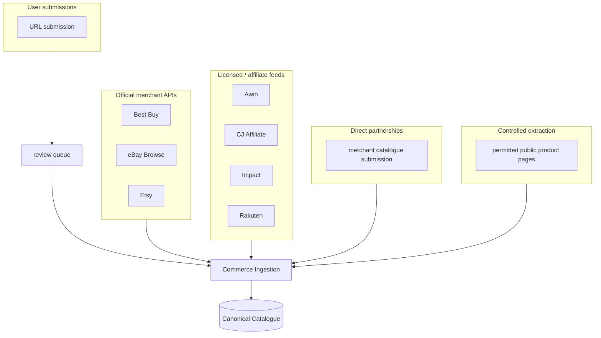
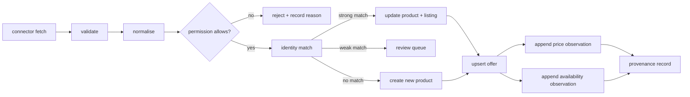
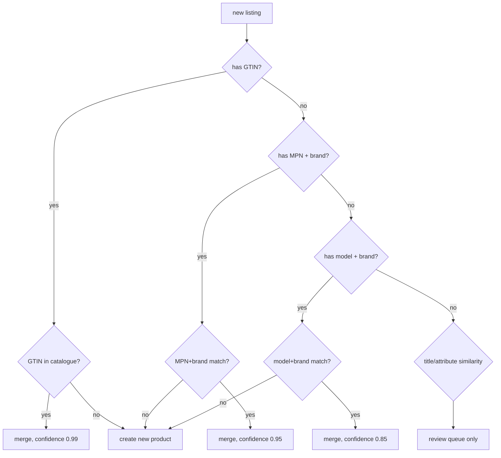

# 04 — Commerce Architecture

**Status:** Proposed for founder review.
**Companion documents:** `03_COMMERCE_DATA_RESEARCH.md`, `05_UNIFIED_SEARCH_ARCHITECTURE.md`, `06_DATABASE_AND_API_SPEC.md`.
**Locked decisions honoured:** hybrid catalogue, India + global coverage, PostgreSQL, modular deployment, multiple independent sources.

---

## 1. Design Goal

Build a commerce intelligence layer that combines **official APIs, licensed feeds, affiliate networks, partnerships, merchant-authorized integrations, permitted public extraction, and (optionally) user-submitted URLs** — while never assuming that public availability implies permission to extract, store, or redistribute.

---

## 2. Source Categories



**Every source has a `source_permission` row** recording what is permitted (see `06 §3.1`). Without it, ingestion refuses to run.

---

## 3. Ingestion Architecture

### 3.1 Connector contract

Every connector implements the same trait:

```rust
#[async_trait]
pub trait Connector: Send + Sync {
    fn name(&self) -> &str;
    fn source_type(&self) -> SourceType;

    /// Fetch and normalise into canonical `RawListing` values.
    async fn fetch(&self, ctx: &IngestionContext) -> Result<Vec<RawListing>, ConnectorError>;

    /// Report health without ingesting.
    async fn health_check(&self) -> Result<Health, ConnectorError>;
}
```

**Canonical `RawListing`:**

```rust
pub struct RawListing {
    pub source_listing_ref: String,          // merchant SKU / listing id
    pub listing_url: String,
    pub title: String,
    pub brand: Option<String>,
    pub identifiers: Vec<RawIdentifier>,     // gtin / mpn / model / asin
    pub attributes: BTreeMap<String, String>,
    pub price: Option<RawPrice>,
    pub availability: Option<AvailabilityState>,
    pub shipping: Vec<RawShipping>,
    pub condition: ConditionType,
    pub image_urls: Vec<String>,
    pub description: Option<String>,
    pub raw_payload_ref: String,             // where the source payload is stored
    pub observed_at: DateTime<Utc>,
}
```

### 3.2 Ingestion pipeline



### 3.3 Ingestion run recording

Every execution writes an `ingestion_run` row with counts and rejection reasons. **A run that ingests zero records is itself a signal** — it usually means the source changed shape or credentials expired.

---

## 4. Canonical Data Model

Defined in full in `06 §3.2`. The conceptual distinctions that matter:

### 4.1 Product vs. Merchant Listing

| Concept | Meaning | Example |
|---|---|---|
| `product` | A real-world item, independent of who sells it | "Sony WH-1000XM5, black" |
| `merchant_listing` | A specific merchant's page/SKU for that product | "Best Buy SKU 6470332" |
| `offer` | A merchant's sellable proposition at a point in time | "$299.00, new, in stock" |

**A product has many listings. A listing has many offers over time.**

### 4.2 Product vs. Variant

Variants differ by attributes that matter to a buyer (colour, size, capacity). A variant belongs to exactly one product.

**Rule:** variants are only split when the source explicitly models them, or when attributes are structurally distinct. Never split on cosmetic title differences.

### 4.3 Current Price vs. Price Observation

- `offer.current_price` is the latest known price — a cache.
- `price_observation` is the append-only history — the truth.

**The history is never overwritten.** Corrections are new observations.

### 4.4 Unavailable vs. Missing

| State | Meaning | Representation |
|---|---|---|
| Unavailable | We observed it; it is out of stock | `availability_observation.state = 'out_of_stock'` |
| Missing | We have no record | no row at all |
| Unknown | Source did not say | `state = 'unknown'` |

**These are different and must never be conflated.** A missing record must not be displayed as "out of stock".

### 4.5 Verified vs. Fuzzy Identifier

| State | Meaning |
|---|---|
| Verified | The identifier was observed from a source that asserts it (merchant feed, official API) |
| Fuzzy | Derived from title/attribute similarity; not asserted by any source |

**Fuzzy identifiers must never be used to merge products automatically.**

---

## 5. Product Identity Resolution

### 5.1 Identifier hierarchy

Strongest to weakest:

1. **GTIN** (EAN/UPC/ISBN/ITF-14) — globally unique.
2. **ASIN** — Amazon-specific, strong within Amazon.
3. **MPN + brand** — manufacturer part number, strong when brand is known.
4. **Model number + brand** — strong for electronics.
5. **Attribute signature** — medium; requires multiple matching attributes.
6. **Title similarity** — weak; **review only**.

### 5.2 Matching rules



### 5.3 Merge thresholds

| Confidence | Action |
|---|---|
| ≥ 0.95 with a strong identifier | auto-merge |
| 0.80 – 0.95 | auto-merge with a review sample |
| 0.50 – 0.80 | review queue |
| < 0.50 | never merge; create a separate product |

**These thresholds are configuration, not constants in code**, and must be tuned against the benchmark suite (see `08`).

### 5.4 Never merge on

- Title similarity alone.
- A shared brand.
- A shared category.
- Image similarity alone (can be used as supporting evidence only).

---

## 6. Offer Aggregation

For a product, aggregate offers across merchants:

1. Deduplicate by `(merchant, listing, condition, currency)` keeping the latest observation.
2. Convert currencies using a dated reference-rate table.
3. Rank by the unified ranking model (see `05 §5`) — **never by commission**.
4. Flag price outliers for review rather than silently dropping them.
5. Demote stale offers; never silently remove them.

---

## 7. Provenance and Freshness

### 7.1 Provenance

Every price and availability observation carries a `provenance_record` with: source, ingestion run, fetch attempt, permission, raw reference, raw hash, extraction method, extraction time, retention deadline, and redistribution permission.

**A fact without provenance must not be displayed.**

### 7.2 Freshness

| Data | Target | Stale behaviour |
|---|---|---|
| Price | 1-24 hours | demote + label age |
| Availability | 1-24 hours | demote + label age |
| Product identity | months | no action |
| Merchant trust | months | re-verify on incident |

Every displayed price shows its observation time.

---

## 8. Source Permission Enforcement

The ingestion pipeline checks `source_permission` **before** writing:

| Permission | Allows |
|---|---|
| `may_extract` | parsing facts out of source data |
| `may_store` | retaining those facts |
| `may_redistribute` | displaying them to users |

If `may_redistribute` is false, the data may be ingested for internal purposes (e.g. aggregation) but **must not appear in any API response**. This is enforced in the API layer and tested.

---

## 9. India and Global Coverage

Detailed provider research is in `03_COMMERCE_DATA_RESEARCH.md`. Summary of the architectural implication:

| Region | Realistic primary sources | Notes |
|---|---|---|
| India | Flipkart/Amazon India affiliate feeds where permitted; merchant partnerships; licensed feeds | Affiliate programme terms vary; some require Indian residency or GST |
| Global | Best Buy API (free key), eBay Browse API (restricted), Etsy, Awin/CJ/Impact/Rakuten feeds | eBay's non-co-mingling clause is a structural problem |

**Architecture must not assume any single source works.** Every connector is optional and independently deployable.

---

## 10. Open Questions

1. **Which affiliate programmes are actually accessible** to an entity in the founder's jurisdiction? Needs verification.
2. **Is price display permitted** for each source? Per-source legal review required.
3. **What attribution is required**, and where must it appear?
4. **Currency conversion source** and update cadence.
5. **Identity thresholds** must be tuned against real data; initial values are proposals.
6. **User-submitted URLs** — in scope for MVP or deferred? Recommendation: defer.

---

*Proposal only. Not approved architecture until founder sign-off. Provider claims in `03` are sourced; legal conclusions require counsel.*
