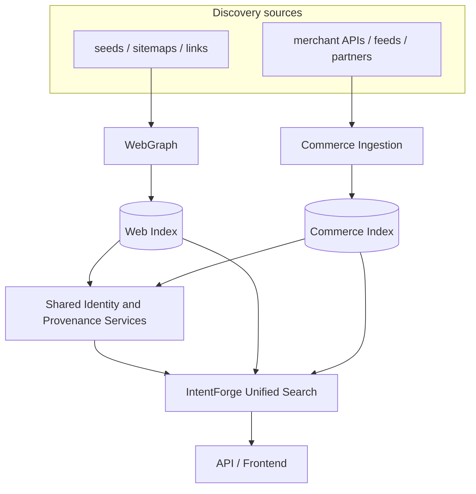
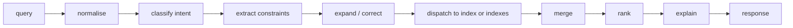

# 05 — Unified Search Architecture

**Status:** Proposed for founder review.
**Companion documents:** `02_WEBGRAPH_ARCHITECTURE.md`, `04_COMMERCE_ARCHITECTURE.md`, `06_DATABASE_AND_API_SPEC.md`.

---

## 1. Design Goal

WebGraph and Commerce Intelligence must **cooperate without merging**. They have different update cadences, different permission models, different data shapes, and different failure modes. The unified layer is a **read-time composition**, not a shared write path.



**Key principle:** neither index writes into the other. They meet only through the identity and provenance services, and only at read time.

---

## 2. Why Not One Index

| Dimension | WebGraph | Commerce Index | Consequence |
|---|---|---|---|
| Update cadence | Days to months | Minutes to hours | Shared write path would couple unrelated SLAs |
| Record unit | Page | Product / offer / observation | Different identity models |
| Permission model | Crawl + index + redistribute | Extract + store + redistribute price | Different legal basis |
| Volume shape | Many pages, few facts each | Few products, many observations | Different storage and partitioning |
| Failure mode | Stale page | Stale price | Different freshness semantics |

Merging them would force one schema to serve both, and one failure domain to take down both.

---

## 3. Shared Identity and Provenance Services

This is the **only** shared subsystem.

### 3.1 Identity resolution

Determines "are these two things the same product?" Used by both indexes at read time.

**Inputs:** identifiers (GTIN/UPC/EAN/ISBN/ASIN/MPN/model), brand, title, attributes.

**Rules:**
1. Strong identifier match → merge with high confidence.
2. MPN + brand match → merge with high confidence.
3. Model number + brand → merge with medium-high confidence.
4. Attribute signature → merge with medium confidence.
5. Title similarity alone → **never auto-merge.** Goes to review.

**Output:** a `product_id` with `identity_confidence` and `identity_method`, plus a review queue for anything below threshold.

### 3.2 Provenance service

Answers, for any displayed fact: *where did this come from, under what permission, and when?*

Every search result carries a provenance object:

```json
{
  "source_id": 9,
  "source_type": "merchant_api",
  "permission_id": 4,
  "may_redistribute": true,
  "observed_at": "2026-11-09T10:00:00Z",
  "ingestion_run_id": 881
}
```

**If `may_redistribute` is false, the fact must not be displayed.** This is enforced in the API layer, not left to the frontend.

---

## 4. Query Understanding

### 4.1 Intent classification

The existing gateway already performs intent classification (`informational`, `transactional`, `comparison`, `local`, `news`, `how-to`, `fresh`). This capability is retained and extended.

| Intent | Primary index | Secondary index | Notes |
|---|---|---|---|
| informational | Web | — | |
| navigational | Web | — | |
| transactional | Commerce | Web | product results + supporting pages |
| comparison | Commerce | Web | needs offer aggregation |
| local | Web + POI | Commerce | geo-constrained |
| news | Web | — | freshness-weighted |
| how-to | Web | — | |
| fresh | Web | — | freshness-weighted |

### 4.2 Query analysis pipeline



**Constraints extracted:** price bounds, brand, model, merchant, country, language, date range, and explicit operators (`site:`, `inurl:`, `intitle:`, `intext:`, `after:`, `before:`).

### 4.3 Product-specific filters

- Price range, brand, merchant, availability, condition, country, currency.
- Filters must be **accurate**: a filter that silently drops valid results is worse than no filter. Every filter reports how many results it removed.

---

## 5. Ranking

### 5.1 Non-negotiable constraint

> **Ranking must not be influenced by affiliate commission or payment.**

This is enforced structurally, not by policy alone:

1. The ranking function receives **no commission field**.
2. The offer table has no commission column.
3. Affiliate metadata lives in a separate table used only at link-generation time, after ranking.
4. A test asserts that permuting affiliate rates does not change ranked order.

### 5.2 Ranking signals

**Web results:**

| Signal | Weight direction | Notes |
|---|---|---|
| Text relevance | strong | FTS + trigram |
| Title match | strong | |
| Structured data quality | medium | presence of schema.org |
| Freshness | medium | decays with age |
| Source trust tier | medium | editorial > partner > directory |
| Internal link centrality | weak | computed over the indexed subset |
| User demand | weak | anonymised, aggregated |

**Commerce results:**

| Signal | Weight direction | Notes |
|---|---|---|
| Product-query relevance | strong | name, brand, attributes |
| Offer competitiveness | strong | price within the observed distribution |
| Availability | strong | in-stock preferred |
| Merchant trust | medium | verified merchants preferred |
| Price freshness | medium | stale prices penalised |
| Shipping cost/speed | weak | only when the user expressed a preference |
| Source reliability | medium | historical accuracy of the source |

**Explicitly excluded:** commission, payment, sponsorship, advertiser status.

### 5.3 Ranking formula (sketch)

```
score = Σ (weight_i × normalised_signal_i) × freshness_decay × trust_multiplier
```

Weights are configuration, not code, and are versioned so that ranking changes are auditable and reversible.

### 5.4 Explanation

Every result carries a short, honest explanation:

```json
{
  "reasons": [
    "title matches 'sony wh-1000xm5'",
    "price is in the lower quartile for this product",
    "in stock at a verified merchant",
    "price observed 2 hours ago"
  ]
}
```

Explanations must never claim a ranking factor that does not exist (e.g. never imply sponsorship).

---

## 6. Search Flows

### 6.1 General web search

```
query → intent=informational → Web Index → rank → explain → response
```

### 6.2 Product search

```
query → intent=transactional
      → Commerce Index (products)
      → for each product, aggregate current offers
      → rank products
      → rank offers within each product
      → explain
      → response
```

### 6.3 Comparison

```
query → intent=comparison
      → extract compared entities
      → fetch each entity's offers
      → build a comparison matrix (price, availability, merchant, shipping)
      → rank by competitiveness
      → explain
```

### 6.4 Local

```
query → intent=local
      → resolve place (explicit location overrides IP-derived)
      → geo-filter Web Index
      → optionally include Commerce offers available in that country
      → rank with geo relevance
```

---

## 7. Offer Aggregation

For a product, offers come from multiple merchants. Aggregation rules:

1. **Deduplicate** by `(merchant, listing, condition, currency)` keeping the most recent observation.
2. **Currency normalise** using a reference rate table with a recorded date. Never mix currencies without conversion.
3. **Sort** by the ranking formula, not by price alone.
4. **Flag divergence**: if an offer's price is far from the distribution, mark it for review rather than silently dropping it.
5. **Staleness**: an offer with no observation within the freshness window is marked stale and demoted, not removed.

---

## 8. Freshness Model

| Data type | Freshness target | Stale behaviour |
|---|---|---|
| Web page | 7-90 days depending on observed change rate | demote, do not remove |
| Product identity | months | no action |
| Price | 1-24 hours | demote and label |
| Availability | 1-24 hours | demote and label |
| Merchant trust | months | re-verify on incident |

**Every displayed price and availability carries its observation timestamp.** A user must always be able to see how old a price is.

---

## 9. Duplicate Suppression

- **Within Web:** canonical URL + content fingerprint clustering.
- **Within Commerce:** identity resolution; one product, many listings.
- **Across both:** a product page in the Web Index and the same product in the Commerce Index are **not duplicates** — they are different result types and may both appear, clearly labelled.

---

## 10. Pagination

- Cursor-based, opaque, signed.
- Cursors encode the last seen sort key, not an offset.
- Deep pagination is bounded; beyond a threshold, the API nudges the user toward refining the query.

---

## 11. API Surface

Defined in `06 §7`. Summary:

| Endpoint | Purpose |
|---|---|
| `GET /api/v1/search` | general web search |
| `GET /api/v1/products` | product search |
| `GET /api/v1/products/{id}` | product detail |
| `GET /api/v1/products/{id}/offers` | merchant offers |
| `GET /api/v1/products/{id}/price-history` | price history |
| `GET /api/v1/products/{id}/availability` | availability |
| `GET /api/v1/merchants/{id}` | merchant information |
| `GET /api/v1/sources/{id}` | source information |
| `POST /api/v1/submissions/urls` | URL submission |
| `POST /api/v1/submissions/catalogues` | merchant catalogue submission |
| `GET/POST /api/v1/admin/...` | crawl and source administration |

---

## 12. Failure Behaviour

| Failure | Behaviour |
|---|---|
| Commerce Index unavailable | Return web results; omit the product strip; say so |
| Web Index unavailable | Return product results if intent is transactional; otherwise a clear error |
| Identity service unavailable | Do not merge; show listings separately with lower confidence |
| Provenance missing | **Do not display the fact** |
| Stale price | Display with an explicit "observed N hours ago" label |
| Partial upstream failure | Return partial results with a `partial_results` flag and a retry hint |

**Never fabricate a result to fill a gap.**

---

## 13. Open Questions

1. **Intent classifier ownership.** Is the existing intent engine retained as the shared classifier, or replaced? Recommendation: retain, extend.
2. **Ranking weight governance.** Who may change weights, and how is a change audited and rolled back?
3. **Comparison depth.** How many entities can be compared at once? Recommendation: 2-4.
4. **Currency conversion source.** Which reference rates, and how often updated?
5. **Explanation depth.** How much explanation is useful without being noisy?
6. **Cross-index dedup policy.** When should a web page and a product result for the same item both appear?

---

*Proposal only. Not approved architecture until founder sign-off.*
