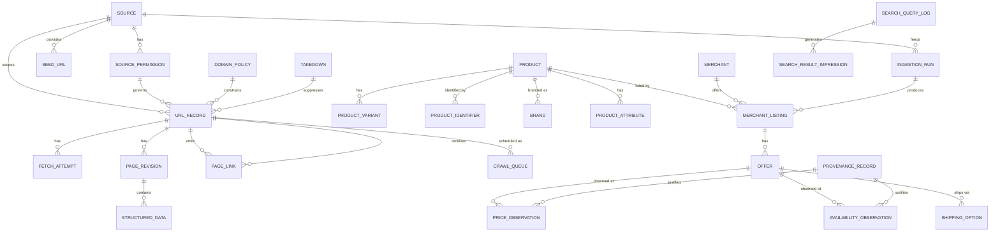

# 06 — Database and API Specification

**Status:** Proposed specification for founder review.
**Companion documents:** `02_WEBGRAPH_ARCHITECTURE.md`, `04_COMMERCE_ARCHITECTURE.md`, `05_UNIFIED_SEARCH_ARCHITECTURE.md`.
**Locked decisions honoured:** PostgreSQL primary database, SQLx for access, modular monolith, API-first.

---

## 1. Design Principles

1. **PostgreSQL is the system of record.** Any inverted index (Tantivy or PostgreSQL's own FTS) is a *projection* rebuilt from these tables.
2. **Provenance is a first-class column, not an afterthought.** Nearly every table carries `source_id`, `ingested_at`, and `policy_version`.
3. **State machines are explicit.** URL lifecycle, ingestion runs, and permission status are enumerations with constrained transitions.
4. **Soft deletion with suppression flags.** Takedowns suppress content without destroying audit history.
5. **Time-series data is separated.** Price and availability observations are append-only and partitioned.
6. **No user tracking tables.** There is no `users`, no `sessions`, no clickstream. Query logs are anonymised and short-lived (see `07`).

---

## 2. Entity Relationship Diagram



---

## 3. Schema

### 3.1 WebGraph tables

#### `source`

A crawler-able or data-providing origin.

```sql
CREATE TABLE source (
    source_id           BIGSERIAL PRIMARY KEY,
    source_type         source_type NOT NULL,          -- 'web_domain', 'merchant_api', 'affiliate_feed', 'partner', 'user_submission'
    display_name        TEXT NOT NULL,
    base_url            TEXT,
    trust_tier          trust_tier NOT NULL DEFAULT 'public_directory',
    -- 'editorial' | 'partner' | 'public_directory' | 'user_submitted'
    contact_email       TEXT,
    bot_page_url        TEXT,
    created_at          TIMESTAMPTZ NOT NULL DEFAULT now(),
    updated_at          TIMESTAMPTZ NOT NULL DEFAULT now(),
    notes               TEXT
);

CREATE INDEX idx_source_type ON source(source_type);
CREATE INDEX idx_source_trust ON source(trust_tier);
```

#### `source_permission`

Granular permission per source. **A single boolean is insufficient** — see `02 §10.2`.

```sql
CREATE TABLE source_permission (
    permission_id       BIGSERIAL PRIMARY KEY,
    source_id           BIGINT NOT NULL REFERENCES source(source_id) ON DELETE CASCADE,
    may_crawl           BOOLEAN NOT NULL DEFAULT false,
    may_index           BOOLEAN NOT NULL DEFAULT false,
    may_extract         BOOLEAN NOT NULL DEFAULT false,
    may_store           BOOLEAN NOT NULL DEFAULT false,
    may_redistribute    BOOLEAN NOT NULL DEFAULT false,
    -- Per-source retention ceiling. Provider terms often cap how long data may be
    -- held (e.g. Amazon Operating Agreement §11(13) caps caching at 24 hours and
    -- §31 prohibits price tracking altogether). NULL means "no special ceiling".
    retention_days      INTEGER,
    permit_scope        TEXT NOT NULL DEFAULT 'all',   -- 'all' | 'paths' | 'none'
    permit_paths        TEXT[],                         -- when scope = 'paths'
    licence_ref         TEXT,                           -- link or identifier
    licence_text        TEXT,                           -- verbatim excerpt
    granted_by          TEXT NOT NULL,
    granted_at          TIMESTAMPTZ NOT NULL DEFAULT now(),
    expires_at          TIMESTAMPTZ,
    revoked_at          TIMESTAMPTZ,
    revocation_reason   TEXT,
    version             INTEGER NOT NULL DEFAULT 1
);

CREATE UNIQUE INDEX ux_permission_source_active
    ON source_permission(source_id)
    WHERE revoked_at IS NULL;

CREATE INDEX idx_permission_expiry ON source_permission(expires_at);
```

#### `domain_policy`

```sql
CREATE TABLE domain_policy (
    domain_policy_id    BIGSERIAL PRIMARY KEY,
    registrable_domain  TEXT NOT NULL UNIQUE,
    crawl_permitted     BOOLEAN NOT NULL DEFAULT false,
    max_concurrency     INTEGER NOT NULL DEFAULT 1,
    min_delay_ms        INTEGER NOT NULL DEFAULT 1000,
    daily_budget        INTEGER NOT NULL DEFAULT 500,
    render_permitted    BOOLEAN NOT NULL DEFAULT false,
    render_budget_daily INTEGER NOT NULL DEFAULT 50,
    max_document_bytes  BIGINT NOT NULL DEFAULT 5242880,  -- 5 MiB
    respect_crawl_delay BOOLEAN NOT NULL DEFAULT true,
    notes               TEXT,
    updated_at          TIMESTAMPTZ NOT NULL DEFAULT now()
);
```

#### `robots_rule`

Cached parsed robots.txt. Re-fetched on TTL expiry.

```sql
CREATE TABLE robots_rule (
    robots_rule_id      BIGSERIAL PRIMARY KEY,
    registrable_domain  TEXT NOT NULL,
    user_agent_token    TEXT NOT NULL,
    allow_paths         TEXT[] NOT NULL DEFAULT '{}',
    disallow_paths      TEXT[] NOT NULL DEFAULT '{}',
    crawl_delay_ms      INTEGER,
    sitemap_urls        TEXT[] NOT NULL DEFAULT '{}',
    raw_text            TEXT,
    fetched_at          TIMESTAMPTZ NOT NULL DEFAULT now(),
    expires_at          TIMESTAMPTZ NOT NULL,
    fetch_status        INTEGER,                        -- HTTP status of the robots.txt fetch
    UNIQUE (registrable_domain, user_agent_token)
);

CREATE INDEX idx_robots_expiry ON robots_rule(expires_at);
```

#### `seed_url`

```sql
CREATE TYPE seed_status AS ENUM ('pending_review', 'approved', 'rejected', 'retired');

CREATE TABLE seed_url (
    seed_id             BIGSERIAL PRIMARY KEY,
    source_id           BIGINT REFERENCES source(source_id),
    seed_url            TEXT NOT NULL UNIQUE,
    trust_tier          trust_tIER NOT NULL DEFAULT 'public_directory',
    topic_tags          TEXT[] NOT NULL DEFAULT '{}',
    status              seed_status NOT NULL DEFAULT 'pending_review',
    include_subdomains  BOOLEAN NOT NULL DEFAULT false,
    path_scope          TEXT[],
    added_by            TEXT NOT NULL,
    reviewed_by         TEXT,
    created_at          TIMESTAMPTZ NOT NULL DEFAULT now(),
    reviewed_at         TIMESTAMPTZ
);
```

#### `url_record`

The central URL lifecycle table. **Every URL ever discovered lives here.**

```sql
CREATE TYPE url_state AS ENUM (
    'discovered',        -- found, not yet evaluated
    'policy_pending',    -- awaiting policy evaluation
    'queued',            -- approved and scheduled
    'fetching',          -- fetch in progress
    'fetched',           -- successfully fetched
    'unchanged',         -- 304 / same fingerprint
    'modified',          -- new fingerprint
    'redirected',        -- moved; target recorded
    'removed',           -- 404/410
    'rejected',          -- policy denied
    'suppressed',        -- takedown / exclusion
    'failed'             -- terminal failure after retries
);

CREATE TABLE url_record (
    url_id              BIGSERIAL PRIMARY KEY,
    url                 TEXT NOT NULL,
    normalized_url      TEXT NOT NULL,
    registrable_domain  TEXT NOT NULL,
    source_id           BIGINT REFERENCES source(source_id),
    discovery_source    discovery_source NOT NULL,
        -- 'seed' | 'sitemap' | 'link' | 'submission' | 'merchant_feed' | 'partner'
    state               url_state NOT NULL DEFAULT 'discovered',
    priority_score      DOUBLE PRECISION NOT NULL DEFAULT 0,
    permission_id       BIGINT REFERENCES source_permission(permission_id),
    domain_policy_id    BIGINT REFERENCES domain_policy(domain_policy_id),
    robots_rule_id      BIGINT REFERENCES robots_rule(robots_rule_id),
    policy_decision     JSONB,                            -- the decision and its inputs
    policy_version      INTEGER NOT NULL DEFAULT 1,
    first_discovered_at TIMESTAMPTZ NOT NULL DEFAULT now(),
    last_checked_at     TIMESTAMPTZ,
    next_review_at      TIMESTAMPTZ,
    fetch_count         INTEGER NOT NULL DEFAULT 0,
    change_count        INTEGER NOT NULL DEFAULT 0,
    failure_count       INTEGER NOT NULL DEFAULT 0,
    last_error          TEXT,
    etag                TEXT,
    last_modified       TIMESTAMPTZ,
    content_type        TEXT,
    canonical_url       TEXT,
    redirect_target_url TEXT,
    suppressed_at       TIMESTAMPTZ,
    suppression_reason  TEXT
);

CREATE UNIQUE INDEX ux_url_normalized ON url_record(normalized_url);
CREATE INDEX idx_url_state ON url_record(state);
CREATE INDEX idx_url_domain ON url_record(registrable_domain);
CREATE INDEX idx_url_next_review ON url_record(next_review_at)
    WHERE state IN ('fetched','unchanged','modified');
CREATE INDEX idx_url_priority ON url_record(priority_score DESC, next_review_at)
    WHERE state = 'queued';
CREATE INDEX idx_url_suppressed ON url_record(suppressed_at)
    WHERE state = 'suppressed';
```

#### `crawl_queue`

PostgreSQL-backed queue. Survives restarts; supports priorities and claims.

```sql
CREATE TABLE crawl_queue (
    queue_id            BIGSERIAL PRIMARY KEY,
    url_id              BIGINT NOT NULL REFERENCES url_record(url_id),
    priority            DOUBLE PRECISION NOT NULL DEFAULT 0,
    not_before          TIMESTAMPTZ NOT NULL DEFAULT now(),
    claimed_by          TEXT,
    claimed_at          TIMESTAMPTZ,
    attempt_count       INTEGER NOT NULL DEFAULT 0,
    created_at          TIMESTAMPTZ NOT NULL DEFAULT now(),
    UNIQUE (url_id)
);

CREATE INDEX idx_queue_due ON crawl_queue(not_before, priority DESC);
CREATE INDEX idx_queue_claim ON crawl_queue(claimed_by, claimed_at)
    WHERE claimed_by IS NOT NULL;
```

#### `fetch_attempt`

Append-only audit of every fetch.

```sql
CREATE TABLE fetch_attempt (
    attempt_id          BIGSERIAL PRIMARY KEY,
    url_id              BIGINT NOT NULL REFERENCES url_record(url_id),
    started_at          TIMESTAMPTZ NOT NULL DEFAULT now(),
    finished_at         TIMESTAMPTZ,
    http_status         INTEGER,
    response_bytes      BIGINT,
    response_hash       BYTEA,                            -- hash of the raw body
    was_conditional     BOOLEAN NOT NULL DEFAULT false,
    not_modified        BOOLEAN NOT NULL DEFAULT false,
    final_url           TEXT,
    error_class         TEXT,
    error_message       TEXT,
    retry_after_secs    INTEGER,
    resolver_ip         INET                              -- SSRF audit
);

CREATE INDEX idx_fetch_url ON fetch_attempt(url_id, started_at DESC);
CREATE INDEX idx_fetch_time ON fetch_attempt(started_at);
```

#### `page_revision`

One row per distinct content version. **This is what makes change detection auditable.**

```sql
CREATE TABLE page_revision (
    revision_id         BIGSERIAL PRIMARY KEY,
    url_id              BIGINT NOT NULL REFERENCES url_record(url_id),
    attempt_id          BIGINT REFERENCES fetch_attempt(attempt_id),
    content_fingerprint BYTEA NOT NULL,
    fingerprint_version INTEGER NOT NULL DEFAULT 1,
    title               TEXT,
    description         TEXT,
    language            TEXT,
    canonical_url       TEXT,
    main_content        TEXT,
    main_content_bytes  INTEGER,
    headings            JSONB,                            -- [{level, text, ordinal}]
    links_out           JSONB,                            -- [{href, anchor_text, rel, ordinal}]
    structured_data_raw JSONB,
    geo_signals         JSONB,
    fetched_at          TIMESTAMPTZ NOT NULL DEFAULT now(),
    is_current          BOOLEAN NOT NULL DEFAULT true,
    UNIQUE (url_id, content_fingerprint)
);

CREATE INDEX idx_revision_current ON page_revision(url_id) WHERE is_current;
CREATE INDEX idx_revision_fingerprint ON page_revision USING HASH (content_fingerprint);
CREATE INDEX idx_revision_language ON page_revision(language);
CREATE INDEX idx_revision_fetched ON page_revision(fetched_at);
```

#### `structured_data`

Parsed structured data, one row per entity.

```sql
CREATE TYPE structured_kind AS ENUM (
    'product', 'offer', 'aggregate_offer', 'review',
    'breadcrumb', 'organization', 'local_business', 'article', 'other'
);

CREATE TABLE structured_data (
    structured_id       BIGSERIAL PRIMARY KEY,
    revision_id         BIGINT NOT NULL REFERENCES page_revision(revision_id),
    kind                structured_kind NOT NULL,
    raw_json            JSONB NOT NULL,
    parsed_json         JSONB,
    schema_version      TEXT,
    extraction_confidence DOUBLE PRECISION,
    created_at          TIMESTAMPTZ NOT NULL DEFAULT now()
);

CREATE INDEX idx_structured_kind ON structured_data(kind);
CREATE INDEX idx_structured_raw ON structured_data USING GIN (raw_json jsonb_path_ops);
```

#### `page_link`

Link graph edges.

```sql
CREATE TABLE page_link (
    link_id             BIGSERIAL PRIMARY KEY,
    source_revision_id  BIGINT NOT NULL REFERENCES page_revision(revision_id),
    target_url_id       BIGINT REFERENCES url_record(url_id),
    target_normalized_url TEXT NOT NULL,
    anchor_text         TEXT,
    rel                 TEXT,
    ordinal             INTEGER NOT NULL,
    created_at          TIMESTAMPTZ NOT NULL DEFAULT now()
);

CREATE INDEX idx_link_source ON page_link(source_revision_id);
CREATE INDEX idx_link_target ON page_link(target_url_id) WHERE target_url_id IS NOT NULL;
```

#### `takedown`

```sql
CREATE TYPE takedown_status AS ENUM ('requested', 'under_review', 'accepted', 'rejected', 'suppressed', 'released');

CREATE TABLE takedown (
    takedown_id         BIGSERIAL PRIMARY KEY,
    scope_type          scope_type NOT NULL,              -- 'url' | 'domain' | 'content_fingerprint'
    scope_value         TEXT NOT NULL,
    reason              TEXT NOT NULL,
    requester_identity  TEXT NOT NULL,
    requester_contact   TEXT,
    evidence_ref        TEXT,
    status              takedown_status NOT NULL DEFAULT 'requested',
    legal_basis         TEXT,
    requested_at        TIMESTAMPTZ NOT NULL DEFAULT now(),
    decided_at          TIMESTAMPTZ,
    decided_by          TEXT,
    decision_note       TEXT,
    suppression_applied_at TIMESTAMPTZ
);

CREATE INDEX idx_takedown_scope ON takedown(scope_type, scope_value);
CREATE INDEX idx_takedown_status ON takedown(status);
```

---

### 3.2 Commerce tables

#### `merchant`

```sql
CREATE TABLE merchant (
    merchant_id         BIGSERIAL PRIMARY KEY,
    source_id           BIGINT REFERENCES source(source_id),
    display_name        TEXT NOT NULL,
    legal_name          TEXT,
    country_code        CHAR(2),
    website_url         TEXT,
    trust_score         DOUBLE PRECISION,                 -- computed, not user-editable
    verified_at         TIMESTAMPTZ,
    created_at          TIMESTAMPTZ NOT NULL DEFAULT now()
);
```

#### `brand`

```sql
CREATE TABLE brand (
    brand_id            BIGSERIAL PRIMARY KEY,
    canonical_name      TEXT NOT NULL UNIQUE,
    aliases             TEXT[] NOT NULL DEFAULT '{}',
    created_at          TIMESTAMPTZ NOT NULL DEFAULT now()
);
```

#### `product`

The **canonical product** — a real-world item, independent of any merchant.

```sql
CREATE TABLE product (
    product_id          BIGSERIAL PRIMARY KEY,
    canonical_name      TEXT NOT NULL,
    brand_id            BIGINT REFERENCES brand(brand_id),
    category_path       TEXT[],
    description         TEXT,
    attributes          JSONB NOT NULL DEFAULT '{}',
    hero_image_url      TEXT,
    created_at          TIMESTAMPTZ NOT NULL DEFAULT now(),
    updated_at          TIMESTAMPTZ NOT NULL DEFAULT now(),
    identity_confidence DOUBLE PRECISION,
    identity_method     identity_method
        -- 'gtin' | 'mpn_brand' | 'model_brand' | 'attribute_signature' | 'manual' | 'unresolved'
);

CREATE INDEX idx_product_name_trgm ON product USING GIN (canonical_name gin_trgm_ops);
CREATE INDEX idx_product_brand ON product(brand_id);
CREATE INDEX idx_product_category ON product USING GIN (category_path);
CREATE INDEX idx_product_attributes ON product USING GIN (attributes jsonb_path_ops);
```

#### `product_variant`

```sql
CREATE TABLE product_variant (
    variant_id          BIGSERIAL PRIMARY KEY,
    product_id          BIGINT NOT NULL REFERENCES product(product_id) ON DELETE CASCADE,
    variant_name        TEXT NOT NULL,
    attributes          JSONB NOT NULL DEFAULT '{}',       -- {color: 'black', size: '10'}
    created_at          TIMESTAMPTZ NOT NULL DEFAULT now(),
    UNIQUE (product_id, variant_name)
);
```

#### `product_identifier`

Every identifier ever observed for a product. **Multiple identifiers per product are normal.**

```sql
CREATE TYPE identifier_type AS ENUM ('gtin','upc','ean','isbn','asin','mpn','sku','model_number','internal');

CREATE TABLE product_identifier (
    identifier_id       BIGSERIAL PRIMARY KEY,
    product_id          BIGINT NOT NULL REFERENCES product(product_id) ON DELETE CASCADE,
    variant_id          BIGINT REFERENCES product_variant(variant_id),
    identifier_type     identifier_type NOT NULL,
    identifier_value    TEXT NOT NULL,
    source_id           BIGINT REFERENCES source(source_id),
    verified            BOOLEAN NOT NULL DEFAULT false,
    first_seen_at       TIMESTAMPTZ NOT NULL DEFAULT now(),
    UNIQUE (identifier_type, identifier_value)
);

CREATE INDEX idx_identifier_product ON product_identifier(product_id);
CREATE INDEX idx_identifier_value ON product_identifier(identifier_value);
```

#### `merchant_listing`

A merchant's own page/SKU for a product. **Distinct from `product`.**

```sql
CREATE TABLE merchant_listing (
    listing_id          BIGSERIAL PRIMARY KEY,
    merchant_id         BIGINT NOT NULL REFERENCES merchant(merchant_id),
    product_id          BIGINT REFERENCES product(product_id),  -- NULL until matched
    variant_id          BIGINT REFERENCES product_variant(variant_id),
    source_id           BIGINT NOT NULL REFERENCES source(source_id),
    merchant_sku        TEXT,
    listing_url         TEXT NOT NULL,
    listing_title       TEXT NOT NULL,
    match_confidence    DOUBLE PRECISION,
    match_method        match_method,                       -- 'gtin' | 'mpn' | 'model' | 'title_similarity' | 'manual' | 'unmatched'
    match_reviewed_by   TEXT,
    first_seen_at       TIMESTAMPTZ NOT NULL DEFAULT now(),
    last_seen_at        TIMESTAMPTZ NOT NULL DEFAULT now(),
    is_active           BOOLEAN NOT NULL DEFAULT true
);

CREATE INDEX idx_listing_product ON merchant_listing(product_id) WHERE product_id IS NOT NULL;
CREATE INDEX idx_listing_merchant ON merchant_listing(merchant_id);
CREATE INDEX idx_listing_url ON merchant_listing(listing_url);
CREATE INDEX idx_listing_match ON merchant_listing(match_confidence)
    WHERE product_id IS NULL;
```

#### `offer`

An offer is a merchant's sellable proposition for a listing at a point in time.

```sql
CREATE TABLE offer (
    offer_id            BIGSERIAL PRIMARY KEY,
    listing_id          BIGINT NOT NULL REFERENCES merchant_listing(listing_id) ON DELETE CASCADE,
    currency_code       CHAR(3) NOT NULL,
    current_price       NUMERIC(14,4) NOT NULL,
    was_price           NUMERIC(14,4),
    condition           condition_type NOT NULL DEFAULT 'new',  -- 'new' | 'refurbished' | 'used' | 'open_box'
    availability        availability_state NOT NULL,            -- 'in_stock' | 'out_of_stock' | 'preorder' | 'unknown'
    observed_at         TIMESTAMPTZ NOT NULL DEFAULT now(),
    source_id           BIGINT NOT NULL REFERENCES source(source_id),
    is_current          BOOLEAN NOT NULL DEFAULT true
);

CREATE INDEX idx_offer_listing_current ON offer(listing_id) WHERE is_current;
CREATE INDEX idx_offer_observed ON offer(observed_at);
```

#### `price_observation` (partitioned, append-only)

```sql
CREATE TABLE price_observation (
    observation_id      BIGSERIAL,
    offer_id            BIGINT NOT NULL REFERENCES offer(offer_id),
    currency_code       CHAR(3) NOT NULL,
    price               NUMERIC(14,4) NOT NULL,
    was_price           NUMERIC(14,4),
    observed_at         TIMESTAMPTZ NOT NULL,
    source_id           BIGINT NOT NULL REFERENCES source(source_id),
    provenance_id       BIGINT REFERENCES provenance_record(provenance_id)
) PARTITION BY RANGE (observed_at);

CREATE INDEX idx_price_offer_time ON price_observation(offer_id, observed_at DESC);
```

**Partitioning:** monthly partitions, created ahead of time, dropped per retention policy.

#### `availability_observation` (partitioned, append-only)

```sql
CREATE TABLE availability_observation (
    observation_id      BIGSERIAL,
    offer_id            BIGINT NOT NULL REFERENCES offer(offer_id),
    state               availability_state NOT NULL,
    observed_at         TIMESTAMPTZ NOT NULL,
    source_id           BIGINT NOT NULL REFERENCES source(source_id),
    provenance_id       BIGINT REFERENCES provenance_record(provenance_id)
) PARTITION BY RANGE (observed_at);

CREATE INDEX idx_avail_offer_time ON availability_observation(offer_id, observed_at DESC);
```

#### `shipping_option`

```sql
CREATE TABLE shipping_option (
    shipping_id         BIGSERIAL PRIMARY KEY,
    offer_id            BIGINT NOT NULL REFERENCES offer(offer_id) ON DELETE CASCADE,
    country_code        CHAR(2) NOT NULL,
    service_name        TEXT,
    price               NUMERIC(14,4),
    currency_code       CHAR(3),
    min_days            INTEGER,
    max_days            INTEGER,
    observed_at         TIMESTAMPTZ NOT NULL DEFAULT now()
);
```

#### `ingestion_run`

Every connector execution is recorded.

```sql
CREATE TYPE ingestion_status AS ENUM ('started','completed','partial','failed','aborted');

CREATE TABLE ingestion_run (
    run_id              BIGSERIAL PRIMARY KEY,
    source_id           BIGINT NOT NULL REFERENCES source(source_id),
    connector_name      TEXT NOT NULL,
    started_at          TIMESTAMPTZ NOT NULL DEFAULT now(),
    finished_at         TIMESTAMPTZ,
    status              ingestion_status NOT NULL DEFAULT 'started',
    records_seen        INTEGER NOT NULL DEFAULT 0,
    records_inserted    INTEGER NOT NULL DEFAULT 0,
    records_updated     INTEGER NOT NULL DEFAULT 0,
    records_rejected    INTEGER NOT NULL DEFAULT 0,
    rejection_reasons   JSONB NOT NULL DEFAULT '{}',
    error_message       TEXT,
    configuration_hash  TEXT                                -- detect config drift
);

CREATE INDEX idx_ingestion_source ON ingestion_run(source_id, started_at DESC);
```

#### `provenance_record`

Why a fact exists. **Required for every observation.**

```sql
CREATE TABLE provenance_record (
    provenance_id       BIGSERIAL PRIMARY KEY,
    source_id           BIGINT NOT NULL REFERENCES source(source_id),
    ingestion_run_id    BIGINT REFERENCES ingestion_run(run_id),
    fetch_attempt_id    BIGINT REFERENCES fetch_attempt(attempt_id),
    permission_id       BIGINT REFERENCES source_permission(permission_id),
    raw_ref             TEXT,                               -- URL, feed filename, API request id
    raw_hash            BYTEA,                              -- hash of the source payload
    extraction_method   TEXT NOT NULL,
    extracted_at        TIMESTAMPTZ NOT NULL DEFAULT now(),
    retention_until     TIMESTAMPTZ,
    may_redistribute    BOOLEAN NOT NULL DEFAULT false
);

CREATE INDEX idx_provenance_source ON provenance_record(source_id, extracted_at DESC);
```

---

### 3.3 Search and audit tables

```sql
CREATE TABLE search_query_log (
    query_log_id        BIGSERIAL PRIMARY KEY,
    query_hash          BYTEA NOT NULL,                     -- salted hash; no raw query text
    anonymised_query    TEXT,                               -- only if retention policy permits
    result_count        INTEGER,
    latency_ms          INTEGER,
    created_at          TIMESTAMPTZ NOT NULL DEFAULT now(),
    retained_until      TIMESTAMPTZ NOT NULL
);

CREATE INDEX idx_query_log_time ON search_query_log(created_at);
CREATE INDEX idx_query_log_retain ON search_query_log(retained_until);

CREATE TABLE audit_event (
    audit_id            BIGSERIAL PRIMARY KEY,
    actor_type          actor_type NOT NULL,                -- 'system' | 'admin' | 'connector' | 'public_api'
    actor_ref           TEXT,
    action              TEXT NOT NULL,
    target_type         TEXT NOT NULL,
    target_ref          TEXT NOT NULL,
    before_state        JSONB,
    after_state         JSONB,
    occurred_at         TIMESTAMPTZ NOT NULL DEFAULT now()
);

CREATE INDEX idx_audit_target ON audit_event(target_type, target_ref, occurred_at DESC);
CREATE INDEX idx_audit_actor ON audit_event(actor_type, actor_ref, occurred_at DESC);
```

---

## 4. Indexing Strategy

| Table | Index | Rationale |
|---|---|---|
| `product` | GIN on `canonical_name` with `pg_trgm` | fuzzy name search |
| `product` | GIN on `attributes jsonb_path_ops` | attribute filtering |
| `product` | GIN on `category_path` | category facet |
| `product_identifier` | btree on `(identifier_type, identifier_value)` | exact identifier lookup |
| `merchant_listing` | btree on `product_id` (partial, non-null) | offer aggregation |
| `merchant_listing` | btree on `match_confidence` (partial, null product) | match review queue |
| `page_revision` | HASH on `content_fingerprint` | dedup |
| `page_revision` | GIN on `headings`, `links_out` | structured queries |
| `structured_data` | GIN on `raw_json jsonb_path_ops` | schema.org queries |
| `price_observation` | btree on `(offer_id, observed_at DESC)` | price history |
| `price_observation` | BRIN on `observed_at` | time-range scans over large partitions |
| `url_record` | btree on `(priority_score DESC, next_review_at)` partial | queue selection |

### Full-text search

```sql
ALTER TABLE page_revision
    ADD COLUMN search_vector TSVECTOR
    GENERATED ALWAYS AS (
        setweight(to_tsvector('english', coalesce(title,'')), 'A') ||
        setweight(to_tsvector('english', coalesce(main_content,'')), 'B')
    ) STORED;

CREATE INDEX idx_revision_fts ON page_revision USING GIN (search_vector);
```

**Recommendation:** use PostgreSQL FTS + `pg_trgm` as the primary search path. Retain Tantivy only if a measured latency or ranking need justifies a second index. Two indexes means two consistency obligations.

---

## 5. Partitioning and Retention

| Table | Strategy | Partition key | Recommended retention |
|---|---|---|---|
| `price_observation` | RANGE, monthly | `observed_at` | 24 months hot, then aggregate and drop |
| `availability_observation` | RANGE, monthly | `observed_at` | 6 months |
| `fetch_attempt` | RANGE, monthly | `started_at` | 12 months |
| `audit_event` | RANGE, monthly | `occurred_at` | 7 years (legal) |
| `search_query_log` | RANGE, monthly | `created_at` | 90 days |
| `page_revision` | no partition; index by `url_id` | — | until URL removed + retention window |

**Retention enforcement:** a scheduled job drops expired partitions and marks records suppressed. Deletion is logged in `audit_event`.

**Per-source ceilings override global defaults.** `source_permission.retention_days` is the binding limit for any record derived from that source; the effective retention is `LEAST(global_default, source_permission.retention_days)`. This is what makes provider terms enforceable rather than aspirational — Amazon-sourced price observations are not retained at all, because Amazon's terms prohibit price tracking (§31), while a partner feed permitting 24 months can retain 24 months.

The price-history API must return an explicit empty result for a source that does not permit retention, rather than silently omitting data.

---

## 6. Migration Strategy

- **Tool:** `sqlx migrate` (fits the locked SQLx decision).
- **Location:** `services/<service>/migrations/`, with a shared `services/database/migrations/` for cross-cutting tables.
- **Rules:**
  - Migrations are immutable once merged.
  - Every migration ships with a verified `DOWN` (even if it is never run in production).
  - Destructive changes require a two-release cycle: add → migrate → remove.
  - All migrations must be idempotent-safe under retry (use `IF NOT EXISTS` where sensible).
  - Large backfills are done in batched background jobs, not in the migration itself.

### Example migrations

```sql
-- 0001_init_webgraph.sql
CREATE TYPE source_type AS ENUM ('web_domain','merchant_api','affiliate_feed','partner','user_submission');
CREATE TYPE trust_tier AS ENUM ('editorial','partner','public_directory','user_submitted');
CREATE TYPE url_state AS ENUM ('discovered','policy_pending','queued','fetching','fetched','unchanged','modified','redirected','removed','rejected','suppressed','failed');
CREATE TYPE discovery_source AS ENUM ('seed','sitemap','link','submission','merchant_feed','partner');

CREATE TABLE source ( /* ... as §3.1 ... */ );
CREATE TABLE source_permission ( /* ... */ );
CREATE TABLE domain_policy ( /* ... */ );
CREATE TABLE robots_rule ( /* ... */ );
CREATE TABLE seed_url ( /* ... */ );
CREATE TABLE url_record ( /* ... */ );
CREATE TABLE crawl_queue ( /* ... */ );
CREATE TABLE fetch_attempt ( /* ... */ );
CREATE TABLE page_revision ( /* ... */ );
CREATE TABLE structured_data ( /* ... */ );
CREATE TABLE page_link ( /* ... */ );
CREATE TABLE takedown ( /* ... */ );
```

```sql
-- 0002_init_commerce.sql
CREATE TYPE identifier_type AS ENUM ('gtin','upc','ean','isbn','asin','mpn','sku','model_number','internal');
CREATE TYPE identity_method AS ENUM ('gtin','mpn_brand','model_brand','attribute_signature','manual','unresolved');
CREATE TYPE match_method AS ENUM ('gtin','mpn','model','title_similarity','manual','unmatched');
CREATE TYPE condition_type AS ENUM ('new','refurbished','used','open_box');
CREATE TYPE availability_state AS ENUM ('in_stock','out_of_stock','preorder','unknown');
CREATE TYPE ingestion_status AS ENUM ('started','completed','partial','failed','aborted');

CREATE TABLE merchant ( /* ... */ );
CREATE TABLE brand ( /* ... */ );
CREATE TABLE product ( /* ... */ );
CREATE TABLE product_variant ( /* ... */ );
CREATE TABLE product_identifier ( /* ... */ );
CREATE TABLE merchant_listing ( /* ... */ );
CREATE TABLE offer ( /* ... */ );
CREATE TABLE shipping_option ( /* ... */ );
CREATE TABLE ingestion_run ( /* ... */ );
CREATE TABLE provenance_record ( /* ... */ );
```

```sql
-- 0003_init_timeseries.sql
CREATE TABLE price_observation ( /* ... */ ) PARTITION BY RANGE (observed_at);
CREATE TABLE availability_observation ( /* ... */ ) PARTITION BY RANGE (observed_at);

-- create the first 13 monthly partitions
SELECT create_monthly_partition('price_observation', generate_series(0, 12));
SELECT create_monthly_partition('availability_observation', generate_series(0, 12));
```

---

## 7. API Specification

### 7.1 Conventions

| Aspect | Decision |
|---|---|
| Versioning | URL path: `/api/v1/...` |
| Format | JSON, UTF-8 |
| Timestamps | RFC 3339 / ISO 8601 with offset |
| Currency | ISO 4217 |
| Country | ISO 3166-1 alpha-2 |
| Pagination | cursor-based (`?cursor=`), never offset-based for large sets |
| Idempotency | `Idempotency-Key` header on mutating endpoints |
| Auth | Admin endpoints: mTLS or signed token. Public search: optional anonymous with strict rate limits. |
| CORS | Restricted to known origins |

### 7.2 Error format

```json
{
  "error": {
    "code": "invalid_parameter",
    "message": "Human-readable description",
    "target": "limit",
    "details": [],
    "request_id": "01J... "
  }
}
```

| HTTP | `code` | Meaning |
|---|---|---|
| 400 | `invalid_parameter` | malformed query parameter |
| 401 | `unauthenticated` | missing/expired credentials |
| 403 | `forbidden` | authenticated but not permitted |
| 404 | `not_found` | resource absent |
| 409 | `conflict` | state transition not allowed |
| 422 | `unprocessable` | semantically invalid |
| 429 | `rate_limited` | too many requests |
| 500 | `internal` | unexpected |
| 503 | `degraded` | partial upstream failure |

### 7.3 General web search

```
GET /api/v1/search?q={query}&limit={n}&cursor={c}&language={lang}&country={cc}
```

```json
{
  "results": [
    {
      "url": "https://example.com/page",
      "title": "Example page",
      "description": "…",
      "language": "en",
      "fetched_at": "2026-11-09T12:00:00Z",
      "provenance": {
        "source_id": 42,
        "permission_id": 7,
        "may_redistribute": true
      }
    }
  ],
  "next_cursor": "eyJ1cmxfaWQiOjEyM30",
  "total_estimate": 128,
  "explanations": [
    { "url": "https://example.com/page", "reasons": ["title_match", "freshness"] }
  ]
}
```

### 7.4 Product search

```
GET /api/v1/products?q={query}&min_price=&max_price=&brand=&merchant=&country={cc}&cursor=
```

```json
{
  "products": [
    {
      "product_id": 1023,
      "canonical_name": "Sony WH-1000XM5",
      "brand": "Sony",
      "category_path": ["Electronics","Headphones","Over-Ear"],
      "hero_image_url": "https://…",
      "identity_confidence": 0.97,
      "identity_method": "gtin",
      "offers": [
        {
          "offer_id": 5501,
          "merchant": { "merchant_id": 12, "display_name": "Example Store" },
          "price": { "amount": "299.00", "currency": "USD" },
          "availability": "in_stock",
          "condition": "new",
          "observed_at": "2026-11-09T10:00:00Z",
          "listing_url": "https://…",
          "provenance": { "source_id": 9, "may_redistribute": true }
        }
      ],
      "price_range": { "min": "279.00", "max": "349.00", "currency": "USD" }
    }
  ],
  "next_cursor": "…",
  "facets": {
    "brand": [{ "value": "Sony", "count": 12 }],
    "merchant": [{ "value": "Example Store", "count": 3 }]
  }
}
```

### 7.5 Product detail

```
GET /api/v1/products/{product_id}
```

Includes variants, identifiers, attributes, offers, price history summary, and provenance.

### 7.6 Merchant offers

```
GET /api/v1/products/{product_id}/offers?country={cc}&currency={cur}
```

Sorted by **relevance and price**, never by commission. See `05 §ranking`.

### 7.7 Price history

```
GET /api/v1/products/{product_id}/price-history?window={30d|90d|1y}&currency={cur}
```

```json
{
  "offer_id": 5501,
  "currency": "USD",
  "series": [
    { "observed_at": "2026-11-01T00:00:00Z", "price": "329.00" },
    { "observed_at": "2026-11-05T00:00:00Z", "price": "299.00" }
  ],
  "statistics": {
    "min": "279.00", "max": "349.00", "median": "310.00",
    "observed_count": 42,
    "first_observed_at": "2025-01-01T00:00:00Z"
  }
}
```

### 7.8 Availability

```
GET /api/v1/products/{product_id}/availability?country={cc}
```

### 7.9 Merchant information

```
GET /api/v1/merchants/{merchant_id}
```

Includes trust score, verification status, and source list.

### 7.10 Source information

```
GET /api/v1/sources/{source_id}
```

Includes permission summary (not licence text), ingestion run history, and freshness statistics.

### 7.11 URL submission

```
POST /api/v1/submissions/urls
Idempotency-Key: <uuid>
```

```json
{
  "url": "https://example.com/product/123",
  "submitter": { "contact": "user@example.com", "role": "public" },
  "reason": "Relevant product page"
}
```

Response: `202 Accepted` with a submission reference. **Submission does not grant permission** — it enters review.

### 7.12 Merchant catalogue submission

```
POST /api/v1/submissions/catalogues
Idempotency-Key: <uuid>
Content-Type: multipart/form-data
```

Accepts CSV/JSON/XML feed. Requires authenticated merchant identity and a signed agreement reference.

### 7.13 Administrative crawl controls

```
GET    /api/v1/admin/crawl/queue?state=queued&domain=&limit=
POST   /api/v1/admin/crawl/queue/{url_id}/pause
POST   /api/v1/admin/crawl/queue/{url_id}/resume
POST   /api/v1/admin/crawl/queue/{url_id}/suppress
POST   /api/v1/admin/crawl/domains/{domain}/policy
GET    /api/v1/admin/crawl/budgets
```

### 7.14 Data source management

```
GET    /api/v1/admin/sources
POST   /api/v1/admin/sources
PATCH  /api/v1/admin/sources/{source_id}
GET    /api/v1/admin/sources/{source_id}/permissions
PUT    /api/v1/admin/sources/{source_id}/permissions
GET    /api/v1/admin/ingestion-runs?source_id=&status=
POST   /api/v1/admin/ingestion-runs/{run_id}/abort
```

### 7.15 Rate limiting

| Tier | Limit | Scope |
|---|---|---|
| Anonymous search | 20 req/min, 200 req/day | per IP |
| Authenticated search | 100 req/min, 5000 req/day | per key |
| Product search | 30 req/min | per key |
| Submission | 5 req/hour | per identity |
| Admin | 600 req/min | per principal |
| Connector ingest | per source, configured | per source |

Responses include `X-RateLimit-Limit`, `X-RateLimit-Remaining`, `X-RateLimit-Reset`.

---

## 8. Connection Pooling and Queue Patterns

- **Pool:** `sqlx::PgPool` with `max_connections` sized to the service (recommended 10-20 per worker, not per request).
- **Queue claim pattern:**

```sql
UPDATE crawl_queue
SET claimed_by = $1, claimed_at = now()
WHERE queue_id = (
    SELECT queue_id FROM crawl_queue
    WHERE claimed_by IS NULL AND not_before <= now()
    ORDER BY priority DESC, not_before ASC
    FOR UPDATE SKIP LOCKED
    LIMIT 1
)
RETURNING *;
```

- **Visibility timeout:** claims expire after N minutes; a reaper returns expired claims to the queue.
- **Scheduling:** `pg_cron` or an in-process scheduler for partition creation and retention enforcement. Prefer in-process to reduce moving parts.

---

## 9. Repository / Module Layout

```
intentforge/
├── services/
│   ├── database/                  # shared SQLx pool, migrations, types
│   │   ├── migrations/
│   │   └── src/lib.rs
│   ├── gateway/                   # public API (existing, extended)
│   ├── webgraph/
│   │   ├── discovery/
│   │   ├── policy/
│   │   ├── crawler/
│   │   ├── renderer/
│   │   └── indexer/
│   ├── commerce/
│   │   ├── ingestion/
│   │   ├── identity/
│   │   └── aggregation/
│   └── benchmark/
├── docs/research-2026-11/
└── deployments/
    └── docker-compose.yml
```

Each `webgraph-*` and `commerce-*` module is an independently runnable binary with its own `Cargo.toml`, sharing only the `database` crate.

---

## 10. Open Questions

1. **PostgreSQL FTS vs. Tantivy.** Recommendation: PostgreSQL FTS primary. Needs a measured comparison before committing.
2. **Partition management.** `pg_cron` vs. application-level scheduler.
3. **Cursor pagination encoding.** Opaque base64 vs. signed tokens.
4. **Retention periods.** Needs founder/legal input per content type.
5. **Identity match thresholds.** What confidence is required before auto-merging? Recommendation: never auto-merge below 0.9 with a strong identifier.
6. **Attribution display.** How and where must source attribution appear?

---

*Proposal only. Not approved architecture until founder sign-off. See `10_OPEN_DECISIONS_AND_RISKS.md`.*
