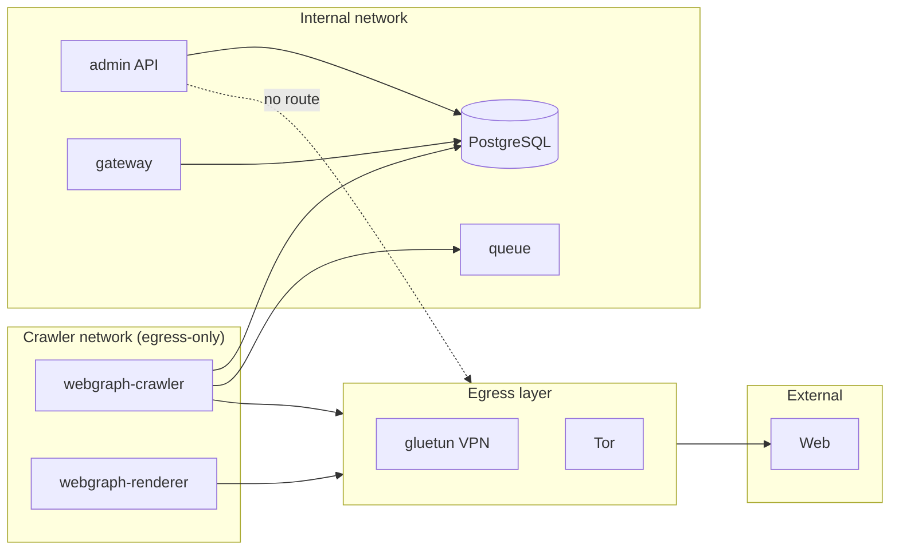
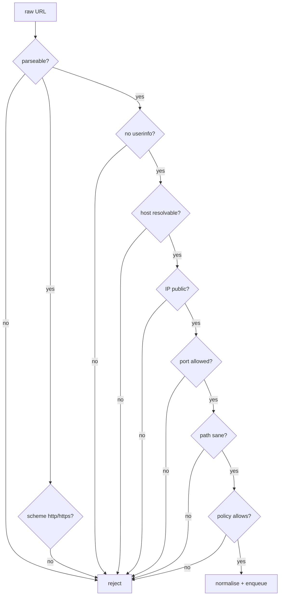

# 07 — Security, Privacy, and Legal Compliance

**Status:** Research draft for founder review. Not legal advice.
**Companion documents:** `02_WEBGRAPH_ARCHITECTURE.md`, `04_COMMERCE_ARCHITECTURE.md`, `06_DATABASE_AND_API_SPEC.md`, `10_OPEN_DECISIONS_AND_RISKS.md`.
**Product principles (non-negotiable, per mission brief):** no advertisements, no selling user data, no cross-site tracking, no paid search ranking, no dark patterns, no surveillance business model, no training on user data without explicit opt-in.
**Research date:** 10 November 2026. All URLs accessed on this date unless otherwise noted.

**Labelling convention:**
- **[CONFIRMED]** — directly supported by a cited primary source (standard, RFC, statute, court opinion, official guidance).
- **[INFERRED]** — reasonable engineering/legal inference from cited sources; not stated verbatim.
- **[UNKNOWN]** — depends on jurisdiction, counsel, or facts not established here.

---

## Contents

1. [Scope and threat model](#1-scope-and-threat-model)
2. [Crawler/fetcher security threats and mitigations](#2-crawlerfetcher-security-threats-and-mitigations)
3. [Web crawling legality and database rights](#3-web-crawling-legality-and-database-rights)
4. [Privacy and data governance](#4-privacy-and-data-governance)
5. [Operational controls summary](#5-operational-controls-summary)
6. [Open questions](#6-open-questions)
7. [Sources](#7-sources)

---

## 1. Scope and threat model

IntentForge is a self-hosted, independent search and product-discovery platform: a Rust crawler/fetcher, a PostgreSQL-backed index, a commerce catalogue, and a public read API. The security surface is unusual in three ways that shape this report:

1. **The crawler is an attacker-controlled fetch engine.** URLs come from the open web and from user submissions, so the fetcher is the primary input-validation boundary. SSRF, DNS rebinding, redirect abuse, and parser attacks are first-order threats, not edge cases.
2. **The crawler is a privacy asset.** If it egresses through VPN/Tor, it is itself an attractive target for abuse (free anonymous web access) and for legal compulsion.
3. **The product is privacy-positive by design.** No accounts, no tracking, no ads, no data sales. This reduces the privacy attack surface but does not eliminate it: crawl logs, query logs, and the index itself are still data with retention, deletion, and disclosure obligations.

### 1.1 Assets

| Asset | Why an attacker wants it |
|---|---|
| Crawler egress (VPN/Tor) | Free anonymous web access; abuse of a privacy infrastructure |
| Fetched content store | Data; also a vector for stored attacks |
| Search index | Poisoning results; SEO manipulation |
| Commerce catalogue | Price/availability manipulation; merchant spoofing |
| Admin API | Control of crawl policy; data deletion |
| Credentials (API keys, merchant tokens) | Financial loss; data access |
| Server resources | CPU, memory, disk, bandwidth exhaustion |

### 1.2 Adversary classes

| Class | Motivation | Capability |
|---|---|---|
| Opportunistic scraper | Free bandwidth/proxying | Low |
| SEO manipulator | Rank poisoning, product impersonation | Medium |
| Malicious publisher | Deliver payloads through crawled content | Medium |
| Merchant/competitor | Price falsification, review manipulation | Medium |
| Insider / compromised admin | Data exfiltration, policy subversion | High |
| Nation-state / legal adversary | Identifying users, compelling data | High |

### 1.3 Threat catalogue index

| ID | Threat | Section |
|---|---|---|
| T1 | Server-Side Request Forgery (SSRF) | §2.1 |
| T2 | DNS rebinding / TOCTOU on resolution | §2.2 |
| T3 | Malicious redirects | §2.3 |
| T4 | Internal network access | §2.4 |
| T5 | Parser and document vulnerabilities | §2.5 |
| T6 | Resource exhaustion and crawl traps | §2.6 |
| T7 | Infinite URL spaces | §2.7 |
| T8 | Credential leakage | §2.8 |
| T9 | Supply-chain vulnerabilities | §2.9 |
| T10 | Data poisoning and merchant spoofing | §2.10 |
| T11 | API abuse | §2.11 |

---

<!-- SECTIONS APPENDED BELOW -->
## 2. Crawler/fetcher security threats and mitigations

The fetcher is the trust boundary. Every URL it accepts is attacker-influenced input, and every response is attacker-controlled content. The controls below are ordered from network-layer to application-layer; each is independently necessary, and none is sufficient alone.

### 2.1 T1 — Server-Side Request Forgery (SSRF)

**Definition [CONFIRMED].** CWE-918 defines SSRF as: "The web server receives a URL or similar request from an upstream component and retrieves the contents of this URL, but it does not sufficiently ensure that the request is being sent to the expected destination." The OWASP SSRF Prevention Cheat Sheet describes the attack as abusing an application to interact with the internal/external network or the machine itself, and lists the canonical targets: cloud metadata (`http://169.254.169.254/`), internal REST interfaces, database HTTP interfaces, and local files via `file://` URIs.
- CWE-918: https://cwe.mitre.org/data/definitions/918.html (accessed 2026-11-10)
- OWASP SSRF Prevention Cheat Sheet: https://cheatsheetseries.owasp.org/cheatsheets/Server_Side_Request_Forgery_Prevention_Cheat_Sheet.html (accessed 2026-11-10)
- OWASP SSRF attack page: https://owasp.org/www-community/attacks/Server_Side_Request_Forgery (accessed 2026-11-10)

**Why a crawler is a high-value SSRF target [INFERRED].** A general-purpose crawler must fetch *arbitrary* URLs, which is exactly the "application can send requests to ANY external IP address or domain name" case in the OWASP cheat sheet. The attacker does not need to exploit a parser bug; they simply submit or link a URL that resolves to an internal address. The crawler's own egress (VPN/Tor) makes it a proxy, so the SSRF also exposes the crawler's network position.

**Mitigations [CONFIRMED as OWASP-recommended; implementation is INFERRED]:**

1. **Denylist non-public address ranges at validation time.** OWASP publishes a denylist of ranges to block, including loopback, RFC 1918 private ranges, link-local (`169.254.0.0/16`, `fe80::/10`), multicast (`224.0.0.0/4`, `ff00::/8`), IPv4-mapped IPv6 (`::ffff:0:0/96`), and NAT64 (`64:ff9b::/96`, `64:ff9b:1::/48`). OWASP explicitly warns to **normalize before comparing**: an IPv4-mapped address (`::ffff:169.254.169.254`) reaches the same host as its IPv4 form, and a NAT64 address does too on networks running a NAT64 gateway, so a check that only matches IPv4-shaped strings is bypassed.
2. **Prefer allowlisting where the crawl scope permits it.** OWASP's Case 1 (identified and trusted applications) is stronger than Case 2 (arbitrary destinations). For a product-discovery crawler, a curated seed/merchant allowlist is feasible and should be the default; open-web crawling is the exception that requires the denylist path.
3. **Disable redirects or validate every hop.** OWASP: "Disable the support for the following of the redirection in your web client in order to prevent the bypass of the input validation." If redirects are required, each hop must be re-validated through the same checks.
4. **Validate the resolved IP, not just the hostname.** OWASP: "Domain allowlisting alone does not prevent DNS rebinding. Validate the resolved destination IP addresses against the application's permitted networks, then ensure the HTTP client connects only to validated addresses."
5. **Network-layer defence in depth.** OWASP recommends enforcing the same policy at the network layer (firewalls, network segmentation) in addition to application-layer checks. For a Docker Compose deployment this means the crawler container gets its own network with no route to internal services.

**Concrete denylist for IntentForge [INFERRED from OWASP + IANA registries]:**

| Range | Purpose |
|---|---|
| `0.0.0.0/8` | "This network" |
| `10.0.0.0/8` | RFC 1918 private |
| `100.64.0.0/10` | CGNAT (RFC 6598) |
| `127.0.0.0/8` | Loopback |
| `169.254.0.0/16` | Link-local, incl. cloud metadata |
| `172.16.0.0/12` | RFC 1918 private |
| `192.0.0.0/24` | IETF protocol assignments |
| `192.0.2.0/24` | TEST-NET-1 |
| `192.168.0.0/16` | RFC 1918 private |
| `198.18.0.0/15` | Benchmarking |
| `198.51.100.0/24` | TEST-NET-2 |
| `203.0.113.0/24` | TEST-NET-3 |
| `224.0.0.0/4` | Multicast |
| `240.0.0.0/4` | Reserved |
| `::/128`, `::1/128` | Unspecified, loopback |
| `::ffff:0:0/96` | IPv4-mapped IPv6 |
| `64:ff9b::/96`, `64:ff9b:1::/48` | NAT64 |
| `100::/64` | Discard-only |
| `2001:db8::/32` | Documentation |
| `fe80::/10` | Link-local |
| `ff00::/8` | Multicast |

Sources: IANA IPv4 Special Registry https://www.iana.org/assignments/iana-ipv4-special-registry/iana-ipv4-special-registry.xhtml and IANA IPv6 Special Registry https://www.iana.org/assignments/iana-ipv6-special-registry/iana-ipv6-special-registry.xhtml (both accessed 2026-11-10; referenced by the OWASP cheat sheet).

### 2.2 T2 — DNS rebinding and resolution TOCTOU

**Definition [CONFIRMED].** OWASP identifies DNS rebinding as a distinct bypass: "An attacker can use it to bind a legit domain name to an internal IP address." It further warns: "A second, unchecked DNS lookup between validation and connection can bypass these checks."
- OWASP SSRF Prevention Cheat Sheet, "Domain name" section: https://cheatsheetseries.owasp.org/cheatsheets/Server_Side_Request_Forgery_Prevention_Cheat_Sheet.html (accessed 2026-11-10)

**Mechanism [INFERRED].** The classic attack is a DNS server under attacker control that answers with a public IP on the first query (validation) and a private/internal IP on the second (connection), often with a TTL of 0. A crawler that resolves, validates, then re-resolves at connect time is vulnerable even with a correct denylist.

**Mitigations [CONFIRMED as OWASP-recommended]:**

1. **Pin the validated IP for the lifetime of the request.** OWASP: "Use an HTTP client mechanism that connects to the validated IP while preserving the original hostname for the HTTP `Host` header, TLS Server Name Indication (SNI), and certificate verification, as illustrated by curl's custom address resolution." In Rust, `reqwest`'s `resolve()` / `resolve_to_addrs()` connector option provides exactly this.
2. **Apply the policy to retries and fallback connections too.** OWASP: "Apply the destination policy to retries and fallback connections as well." A retry that re-resolves silently reintroduces the vulnerability.
3. **Use a controlled resolver with monitoring.** OWASP recommends resolving through a designated resolver and monitoring allowlisted domains for changes to local/private IPs. This is detection, not a substitute for connection-time enforcement.
4. **Verify the `Host` header and TLS certificate match the validated name** so a pinned-IP connection cannot be diverted to a different vhost.

### 2.3 T3 — Malicious redirects

**Scenario.** A crawled page returns `302 Location: http://169.254.169.254/...`, or `Location: file:///etc/passwd`, or a redirect loop.

**Mitigations [CONFIRMED as OWASP-recommended; specifics INFERRED]:**

1. **Validate every redirect target through the same SSRF pipeline** before following. OWASP explicitly calls out "Unsafe redirect" as a bypass of input validation.
2. **Cap redirect hops.** OWASP's guidance is to disable redirects entirely where possible; where they are required, a small hop cap (5 is a common default) plus a loop detector (same URL seen twice) prevents unbounded chains.
3. **Allow only `http` and `https` schemes.** OWASP notes SSRF "is not limited to the HTTP protocol" and that schemes such as `file://`, `phar://`, `gopher://`, `data://`, and `dict://` can be abused. A crawler has no legitimate reason to follow a non-HTTP scheme.
4. **Record the full redirect chain** in `fetch_attempt` for audit and incident response.

### 2.4 T4 — Internal network access

**Mitigations [INFERRED from OWASP network-layer guidance]:**

- **Network segmentation.** The crawler runs in its own Docker network with an egress-only gateway. It has no route to the admin network, the database network, or any internal service except PostgreSQL and the queue, which are reached through explicit internal connectors.
- **No shared Docker socket.** Mounting `/var/run/docker.sock` into the crawler would let a compromised crawler control the host.
- **Egress allowlisting where feasible.** For a product crawler, an allowlist of merchant domains is both a security and a legal control (see §3).
- **Separate the egress layer.** VPN/Tor containers are isolated from the crawler's control plane; the admin API has no route to the egress layer.

### 2.5 T5 — Parser and document vulnerabilities

**Scenario.** Billion-laughs XML entity expansion, deeply nested HTML, decompression bombs, or a memory-safety bug in a parser dependency.

**Mitigations [INFERRED from OWASP guidance on input validation and defence in depth]:**

- **Hard cap on document size** (recommended 5 MiB compressed, 20 MiB decompressed).
- **Cap decompression ratio** (recommended 10:1) for gzip/brotli/zstd responses.
- **Cap nesting depth** in HTML/XML parsers; reject documents exceeding it.
- **Prefer memory-safe parsers** (Rust: `scraper`, `lofty`, `zip` with limits).
- **Run parsing in a process with a memory limit**; treat OOM as a document rejection, not a service failure.
- **Track CVEs for every parser dependency**; automate advisories (`cargo audit`, Dependabot).

**Source:** OWASP Input Validation Cheat Sheet https://cheatsheetseries.owasp.org/cheatsheets/Input_Validation_Cheat_Sheet.html (accessed 2026-11-10) — "accept known good" validation strategy; reject input that does not strictly conform to specifications.

### 2.6 T6 — Resource exhaustion and crawl traps

**Scenario.** A calendar page generates a URL per day; a search page generates a URL per query; a session ID in the path generates a URL per visit. The queue grows without bound.

**Mitigations [INFERRED]:**

- **Per-domain daily budget** (`domain_policy.daily_budget`).
- **Global queue cap** with backpressure.
- **Per-domain concurrency of 1** by default (also a legal/politeness control; see §3).
- **URL pattern analysis:** reject paths with unbounded numeric segments beyond a threshold.
- **Maximum URL length** (e.g. 2048 characters).
- **Maximum pages per domain overall** (configurable).
- **Request timeouts:** 30s connect, 30s read.
- **Circuit breaker:** per-domain failure threshold.

### 2.7 T7 — Infinite URL spaces

**Mitigation [INFERRED]:** normalize URLs aggressively before enqueueing — lowercase scheme and host, drop default ports, drop fragment, sort query parameters, remove known tracking parameters (`utm_*`, `fbclid`, `gclid`, `ref`), collapse duplicate slashes, punycode-encode the host — and reject URLs whose normalized form exceeds a length cap. Normalization both deduplicates the queue and removes a class of tracking-parameter-driven URL explosion.

### 2.8 T8 — Credential leakage

**Scenario.** Merchant API keys or affiliate tokens leaked in logs, error messages, or backups.

**Mitigations [INFERRED]:**

- **Secrets in a dedicated secret store** (Docker secrets or an external vault), never in `docker-compose.yml`, never in environment dumps.
- **Redact authorization headers and query-string credentials** from all logs.
- **Rotate credentials** on a schedule and on any suspected exposure.
- **Per-source credentials**, so compromise is contained.
- **Admin API authentication** via mTLS or signed short-lived tokens.

### 2.9 T9 — Supply-chain vulnerabilities

**Mitigations [INFERRED]:** pin dependency versions, `cargo audit` in CI, `Dockerfile` base images pinned by digest, minimal base images, non-root containers, read-only root filesystems, and regular rebuilds.

### 2.10 T10 — Data poisoning and merchant spoofing

**Scenario.** A publisher embeds hidden text or structured data to manipulate ranking or inject false prices; a seller lists a counterfeit as a genuine product.

**Mitigations [INFERRED]:**

- Extract structured data only from permitted sources.
- Cross-check extracted prices against at least one independent source before displaying; flag divergence.
- Do not index hidden text (CSS-hidden, off-screen) as visible content.
- Record extraction confidence and method.
- Never auto-merge products on weak fuzzy matching; require strong identifiers (GTIN/MPN/model) for identity claims.
- Merchant verification workflow before a merchant is displayed with a trust indicator.
- Human review queue for low-confidence matches.

### 2.11 T11 — API abuse

**Mitigations [INFERRED]:** tiered rate limits (see `06 §7.15`), cursor pagination to prevent deep scraping, CAPTCHA on anonymous submission, per-identity quotas, and anomaly detection on query patterns.

---
## 3. Web crawling legality and database rights

**This entire section is a framework for counsel review, not legal advice.** The legal position is jurisdiction-dependent and fact-dependent. Where a statement is not directly supported by a cited primary source it is labelled [INFERRED] or [UNKNOWN].

### 3.1 robots.txt as a standard — RFC 9309

**Status [CONFIRMED].** RFC 9309, "Robots Exclusion Protocol" (REP), published September 2022, is an IETF Standards Track document (Proposed Standard) authored by M. Koster, G. Illyes, H. Zeller, and L. Sassman. It specifies and extends the protocol originally defined by Martijn Koster in 1994.
- RFC 9309: https://www.rfc-editor.org/rfc/rfc9309.html (accessed 2026-11-10)
- RFC Editor info page: https://www.rfc-editor.org/info/rfc9309 (accessed 2026-11-10)

**What the standard actually says [CONFIRMED, quoted from RFC 9309]:**

| Provision | RFC 9309 text | Implication for IntentForge |
|---|---|---|
| Not access control | "These rules are not a form of access authorization." (§1) | robots.txt is a request, not a permission. Honouring it is not a legal defence. |
| Location | "The rules MUST be accessible in a file named '/robots.txt' (all lowercase) in the top-level path of the service." (§2.3) | Fetch `scheme://authority/robots.txt`. |
| User-agent matching | "Crawlers MUST use case-insensitive matching to find the group that matches the product token." (§2.2.1) | Match the product token case-insensitively; merge multiple matching groups. |
| Fallback | "If no matching group exists, crawlers MUST obey the group with a user-agent line with the '*' value, if present." (§2.2.1) | Fall back to `*`; if no group matches at all, no rules apply. |
| Most specific match | "The most specific match found MUST be used. The most specific match is the match that has the most octets." (§2.2.2) | Longest-match wins; `allow` wins ties. |
| Redirects | "The crawlers SHOULD follow at least five consecutive redirects, even across authorities." (§2.3.1.2) | Follow up to 5 redirects; more than 5 → may treat as unavailable. |
| **Unavailable (4xx)** | "If a server status code indicates that the robots.txt file is unavailable to the crawler, then the crawler MAY access any resources on the server." (§2.3.1.3) | A 404 robots.txt permits crawling per the standard. |
| **Unreachable (5xx / network error)** | "If the robots.txt file is unreachable due to server or network errors, this means the robots.txt file is undefined and the crawler MUST assume complete disallow." (§2.3.1.4) | **Fail closed.** A 5xx or network error means disallow everything on that host. |
| Caching | "Crawlers SHOULD NOT use the cached version for more than 24 hours, unless the robots.txt file is unreachable." (§2.4) | Cache TTL ≤ 24h. |
| Parsing limit | "The parsing limit MUST be at least 500 kibibytes." (§2.5) | Set a parsing limit ≥ 500 KiB to protect the parser. |
| Security | "The Robots Exclusion Protocol is not a substitute for valid content security measures. Listing paths in the robots.txt file exposes them publicly and thus makes the paths discoverable." (§3) | robots.txt is not a security boundary; do not rely on it to hide anything. |

**Operational rule [INFERRED from RFC 9309 + §3.2 below]:** RFC 9309 is a *technical* standard for crawler behaviour. It is not a licence to crawl. A site may simultaneously (a) publish a permissive robots.txt and (b) prohibit automated collection in its terms of service. The two are independent.

### 3.2 Terms of service enforceability

**The core question [UNKNOWN — jurisdiction-dependent].** Whether a site's terms of service (ToS) prohibiting automated collection are enforceable against a crawler depends on the jurisdiction and on how the contract was formed (browse-wrap vs. click-wrap vs. registration).

**General principles [INFERRED from contract law; needs counsel]:**

- **Browse-wrap** (terms linked in a footer, no affirmative action) is the weakest form and is often unenforceable unless the user had actual or constructive notice.
- **Click-wrap** (an "I agree" checkbox) is the strongest form and is generally enforceable.
- **Registration-based** terms (agreeing during account creation) are generally enforceable against the account holder, but a crawler that does not create an account may argue it is not a party to the contract.
- **Cease-and-desist letters** are not court orders; they are evidence of notice. Ignoring one may support a claim of *knowing* violation, which can matter for damages and for CFAA "without authorization" arguments (see §3.4).

**Practical position for IntentForge [INFERRED]:** The default should be **do not crawl** where a site's terms prohibit automated collection, regardless of robots.txt. This is both a legal risk reduction and a reputational one. Each source carries a `source_permission` row recording what is permitted (see `06 §3.1`).

### 3.3 Copyright

**General position [CONFIRMED as a legal principle; application is jurisdiction-dependent].** Copyright protects original expression (text, images, code) but not facts. A price, a product name, and a specification are generally *facts* and are not copyrightable; the *arrangement* and *wording* around them may be.

**Practical implications [INFERRED]:**

| Action | Copyright risk |
|---|---|
| Crawling a public page | Low — transient copying in the course of viewing is generally not infringement in most jurisdictions |
| Indexing metadata (title, URL, price) | Low — facts are not protected |
| Reproducing substantial text or images | High — this is the core exclusive right |
| Reproducing short extracts with attribution | Medium — may be fair use/fair dealing depending on jurisdiction and purpose |
| Redistributing full product descriptions | High |

**Jurisdiction note [UNKNOWN]:** The US fair use doctrine (17 U.S.C. §107) is more permissive than the EU's closed-list exceptions. The UK's fair dealing is narrower still. A product operating in multiple jurisdictions must apply the strictest applicable rule.

### 3.4 The EU sui generis database right

**Statutory basis [CONFIRMED].** Directive 96/9/EC of the European Parliament and of the Council of 11 March 1996 on the legal protection of databases creates a *sui generis* right for the maker of a database.
- Directive 96/9/EC (EUR-Lex): https://eur-lex.europa.eu/legal-content/EN/TXT/HTML/?uri=CELEX:31996L0009 (accessed 2026-11-10)
- WIPO Lex summary: https://www.wipo.int/wipolex/en/legislation/details/1409 (accessed 2026-11-10)

**Key provisions [CONFIRMED, quoted]:**

> "Member States shall provide for a right for the maker of a database which shows that there has been qualitatively and/or quantitatively a substantial investment in either the obtaining, verification or presentation of the contents to prevent extraction and/or re-utilization of the whole or of a substantial part, evaluated qualitatively and/or quantitatively, of the contents of that database." — Article 7(1)

> "'extraction' shall mean the permanent or temporary transfer of all or a substantial part of the contents of a database to another medium by any means or in any form." — Article 7(2)(a)

> "'re-utilization' shall mean any form of making available to the public all or a substantial part of the contents of a database by the distribution of copies, by renting, by on-line or other forms of transmission." — Article 7(2)(b)

**What this means for a crawler [INFERRED]:**

- The right protects against **extraction** (transferring contents to another medium) and **re-utilization** (making contents available to the public).
- The threshold is **"substantial part, evaluated qualitatively and/or quantitatively"** — a small number of highly valuable records can be a substantial part qualitatively.
- The right applies to **systematic extraction**. Crawling a product catalogue and republishing it is the paradigm case of what the right is designed to prevent.
- The right is **not** infringed by extracting *insubstantial* parts, but repeated or systematic extraction of insubstantial parts that reconstructs a substantial part can infringe (see *Football Dataco v. Sportradar*, C-173/11, and the CJEU's case law on "repeated and systematic" extraction).
- The right is **independent of copyright**. A database that lacks sufficient originality for copyright may still qualify for *sui generis* protection if there was substantial investment in obtaining, verifying, or presenting the contents.

**CJEU case law [CONFIRMED]:**

- *British Horseracing Board v. William Hill* (C-203/02) — the *sui generis* right protects the investment in obtaining/verifying contents, not the investment in creating the data.
- *Football Dataco v. Sportradar* (C-173/11) — extraction of insubstantial parts on a repeated or systematic basis may infringe if it reconstructs a substantial part.
- *CV-Online Latvia* (C-762/19) — the operation of a news aggregator may constitute extraction/re-utilization.

**Practical position for IntentForge [INFERRED]:** Do not systematically extract and republish a substantial part of a third-party database. Index metadata and short extracts with attribution; do not reproduce the catalogue. Record provenance on every stored fact so that a takedown can be executed (see §4.4).

### 3.5 Relevant US case law

#### 3.5.1 *Van Buren v. United States*, 593 U.S. 374 (2021)

**Holding [CONFIRMED, quoted from the opinion]:** "An individual 'exceeds authorized access' when he accesses a computer with authorization but then obtains information located in particular areas of the computer—such as files, folders, or databases—that are off-limits to him." The Court held that the CFAA's "exceeds authorized access" clause (18 U.S.C. §1030(e)(6)) does **not** cover a person who has improper motives for obtaining information that is otherwise available to them.
- Opinion: https://www.supremecourt.gov/opinions/20pdf/19-783_k53l.pdf (accessed 2026-11-10)

**Implication [INFERRED]:** *Van Buren* narrowed the CFAA's "exceeds authorized access" prong to a "gates-up-or-down" inquiry. A crawler that accesses publicly available pages is not "exceeding authorized access" merely because it violates a site's terms of service. This reduces *criminal* exposure in the US but does **not** eliminate civil claims (breach of contract, copyright, trespass to chattels, DMCA §1201).

#### 3.5.2 *hiQ Labs, Inc. v. LinkedIn Corp.*, 31 F.4th 1180 (9th Cir. 2022)

**Holding [CONFIRMED, quoted from the opinion]:** On remand from the Supreme Court, the Ninth Circuit again affirmed the preliminary injunction, concluding that hiQ had raised serious questions about whether LinkedIn could invoke the CFAA to preempt hiQ's tortious interference claim. The panel held that "a plaintiff seeking a preliminary injunction must establish that it is likely to succeed on the merits..." and that hiQ had raised a serious question as to whether the CFAA "without authorization" concept is inapplicable where, as here, prior authorization is not generally required but a particular person—or bot—is refused access.
- Opinion: https://cdn.ca9.uscourts.gov/datastore/opinions/2022/04/18/17-16783.pdf (accessed 2026-11-10)

**Implication [INFERRED]:** *hiQ* suggests that scraping *publicly available* data is unlikely to violate the CFAA's "without authorization" prong, at least in the Ninth Circuit. However:
- The case was a **preliminary injunction**; the court did not resolve the merits.
- The CFAA is a **criminal** statute; the case does not address breach of contract, copyright, or the *sui generis* database right.
- The court explicitly noted that LinkedIn remained free to use "technological self-help" (antibot measures) against bad actors.
- The case is **binding only in the Ninth Circuit**; other circuits may differ.

#### 3.5.3 Other relevant US law [INFERRED; needs counsel]

- **18 U.S.C. §1030 (CFAA)** — criminal and civil liability for unauthorised access.
- **17 U.S.C. §1201 (DMCA anti-circumvention)** — bypassing technical access controls may be a violation independent of copyright.
- **Trespass to chattels** — a common-law claim for unauthorised use of a server; largely superseded by the CFAA after *Van Buren* but still available in some jurisdictions.
- **California Penal Code §502** — state-level computer crime statute, broader than the CFAA.

### 3.6 The distinction between crawling, indexing, extracting, storing, and redistributing

These five verbs describe a chain of activities with **different legal risks at each step**. The distinction matters because a platform may be lawful at one step and unlawful at the next.

| Step | What it is | Legal risk | Key question |
|---|---|---|---|
| **Crawling** | Fetching a public URL | Low | Is the page publicly accessible? Does robots.txt/ToS permit it? |
| **Indexing** | Recording metadata (URL, title, snippet) for search | Low–Medium | Is the metadata a fact (unprotected) or a reproduction (protected)? |
| **Extracting** | Structured parsing of specific fields (price, GTIN, availability) | Medium | Does the extraction constitute a "substantial part" of a protected database? |
| **Storing** | Persisting the extracted data in a database | Medium–High | Is the storage an "extraction" under Art. 7(2)(a)? Is it a "re-utilization"? |
| **Redistributing** | Making the data available to the public | High | Is the redistribution a "re-utilization" under Art. 7(2)(b)? Is it a copyright infringement? |

**Operational rule [INFERRED]:** Record permission for each step separately in `source_permission` (see `06 §3.1`). A source may permit crawling but not extraction; a source may permit extraction but not redistribution. The platform's default should be the **most restrictive** step permitted.

**Practical examples [INFERRED]:**

- Crawling a product page and indexing its title and URL: likely low risk.
- Extracting the price and GTIN and storing them: medium risk (facts, but systematic extraction may engage the *sui generis* right).
- Republishing the merchant's full product description: high risk (copyright).
- Republishing the entire catalogue of a competitor: very high risk (*sui generis* right, copyright, breach of contract).

---
## 4. Privacy and data governance

IntentForge's product principles are privacy-positive: no accounts, no tracking, no ads, no data sales. This section translates those principles into concrete governance controls. **The legal obligations below apply only if the platform processes personal data; whether it does is a fact question that depends on the implementation [UNKNOWN].**

### 4.1 Does the platform process personal data?

**The threshold question [UNKNOWN — depends on implementation].** Under GDPR Article 4(1), "personal data" means any information relating to an identified or identifiable natural person. A search query containing a person's name, a crawl log containing an IP address, or a merchant contact record are all potentially personal data.

**Practical position [INFERRED]:** Assume the platform processes *some* personal data (at minimum, server logs containing IP addresses, and any merchant contact details). Design to that assumption; it is cheaper than retrofitting.

### 4.2 GDPR principles (if GDPR applies)

**Applicability [CONFIRMED].** GDPR applies to processing of personal data by a controller/processor established in the EU, or by one outside the EU that offers goods/services to EU data subjects or monitors their behaviour (Art. 3 GDPR). For a self-hosted platform, the question is whether the operator is established in the EU or targets EU users.
- GDPR text: https://gdpr-info.eu/ (accessed 2026-11-10)

**Article 5 principles [CONFIRMED, quoted]:**

| Principle | GDPR Art. 5 text | Operational control |
|---|---|---|
| Lawfulness, fairness, transparency | "processed lawfully, fairly and in a transparent manner" | Publish a privacy notice; document legal basis for each processing purpose |
| Purpose limitation | "collected for specified, explicit and legitimate purposes and not further processed in a manner that is incompatible" | Record purpose per data category; do not repurpose |
| Data minimisation | "adequate, relevant and limited to what is necessary" | Do not collect what is not needed; salt and hash query text |
| Accuracy | "accurate and, where necessary, kept up to date" | Correct or erase inaccurate data on request |
| Storage limitation | "kept in a form which permits identification of data subjects for no longer than is necessary" | Retention schedule; automated deletion |
| Integrity and confidentiality | "processed in a manner that ensures appropriate security" | Encryption, access control, audit logging |
| Accountability | "The controller shall be responsible for, and be able to demonstrate compliance" | Records of processing (Art. 30), DPIA where required (Art. 35) |

Source: https://gdpr-info.eu/art-5-gdpr/ (accessed 2026-11-10)

### 4.3 Data retention

**Principle [CONFIRMED].** GDPR Art. 5(1)(e) requires storage limitation: personal data must be kept no longer than necessary for the purposes for which it is processed.
- https://gdpr-info.eu/art-5-gdpr/ (accessed 2026-11-10)

**Proposed retention schedule [INFERRED — needs founder and counsel input]:**

| Data | Purpose | Proposed retention | Rationale |
|---|---|---|---|
| Salted query hash | Abuse detection, rate limiting | 90 days | Short; sufficient for abuse detection |
| Anonymised query text | Relevance improvement | 90 days, opt-out respected | Short; minimises identifiability |
| Aggregated result counts | Quality monitoring | Indefinite (no identifier) | Not personal data |
| Latency metrics | Performance | 90 days | Short; no identifier |
| Crawl metadata (URL, fetch time, status) | Index operation | Per content retention policy | Operational necessity |
| Server logs (IP addresses) | Security, abuse prevention | 30–90 days | Short; minimises identifiability |
| Merchant contact details | Commerce operations | Duration of relationship + legal limitation period | Contractual necessity |

**Operational control [INFERRED]:** Automate retention expiry via partition drop or scheduled job; log every deletion in `audit_event`.

### 4.4 Deletion workflows

**Right to erasure [CONFIRMED].** GDPR Art. 17 gives data subjects the right to obtain erasure of personal data "without undue delay" on specified grounds, including that the data is no longer necessary, consent is withdrawn, or the data was unlawfully processed. Art. 17(2) requires the controller to take "reasonable steps, including technical measures, to inform controllers which are processing the personal data that the data subject has requested the erasure by such controllers of any links to, or copy or replication of, those personal data."
- https://gdpr-info.eu/art-17-gdpr/ (accessed 2026-11-10)

**Three deletion workflows [INFERRED]:**

1. **Takedown / exclusion request.** A source (merchant, publisher, or individual) requests that their content be removed from the index. Workflow: suppress immediately in the index; mark the record as suppressed; propagate to backups per a documented schedule; log in `audit_event`.
2. **Retention expiry.** Automated partition drop or scheduled deletion when the retention period ends; logged in `audit_event`.
3. **Full deletion on source revocation.** When a source's permission is revoked, remove all derived records and mark provenance as revoked.

**Backups [INFERRED]:** Backups must be included in the deletion workflow. A documented schedule (e.g. "backups are rotated every 30 days; deletion propagates on the next rotation") is defensible; indefinite retention of backups containing deleted data is not.

### 4.5 Takedown and exclusion requests

**Channels [INFERRED]:** Provide a public, no-login-required takedown form and a dedicated email address. A source should be able to request exclusion without creating an account.

**Categories of request [INFERRED]:**

| Request type | Example | Action |
|---|---|---|
| Copyright takedown | "You reproduce my product description" | Suppress the content; review; restore if mistaken |
| Database right objection | "You extracted my catalogue" | Suspend extraction from that source; review |
| Personal data erasure | "Remove my name from your index" | Erase the personal data; verify |
| robots.txt change | Site updates robots.txt to disallow | Re-fetch robots.txt; stop crawling; remove existing content |
| DMCA §512 notice | US copyright notice | Comply with §512(c) procedures if applicable |

**DMCA note [CONFIRMED as US law; applicability is UNKNOWN].** 17 U.S.C. §512(c) provides a safe harbour for online service providers that store user-generated content, conditional on implementing a notice-and-takedown procedure. Whether a search engine qualifies is a legal question; the procedures are nonetheless good practice.
- Copyright Office: https://www.copyright.gov/ (accessed 2026-11-10)

### 4.6 Audit logging

**Principle [CONFIRMED].** GDPR Art. 32 requires "a process for regularly testing, assessing and evaluating the effectiveness of technical and organisational measures." Art. 30 requires records of processing activities.
- Art. 32: https://gdpr-info.eu/art-32-gdpr/ (accessed 2026-11-10)
- Art. 30: https://gdpr-info.eu/art-30-gdpr/ (accessed 2026-11-10)

**What to log [INFERRED]:**

| Event | Fields |
|---|---|
| Administrative action | Actor, target, before/after state, timestamp, source IP |
| Policy change | Actor, policy ID, old value, new value, timestamp |
| Takedown request | Requester, target record, action taken, timestamp |
| Deletion | Record ID, reason, actor, timestamp |
| Crawl policy decision | Domain, decision (allow/deny), reason, timestamp |
| Access to personal data | Actor, record ID, purpose, timestamp |

**Properties [INFERRED]:** Append-only; retained longer than content; access restricted to authorised administrators; regularly reviewed.

### 4.7 Privacy-by-design patterns

**Article 25 GDPR [CONFIRMED].** "The controller shall implement appropriate technical and organisational measures for ensuring that, by default, only personal data which are necessary for each specific purpose of the processing are processed."
- https://gdpr-info.eu/art-25-gdpr/ (accessed 2026-11-10)

**Patterns [INFERRED from Art. 25 and Art. 5]:**

| Pattern | Implementation |
|---|---|
| Data minimisation | Collect only what is needed; do not build user profiles |
| Pseudonymisation | Salted hashes for query text; separate salt from data |
| Purpose limitation | Record purpose per data category; enforce in code |
| Storage limitation | Automated retention expiry; partition drop |
| Default privacy | No accounts by default; no tracking by default |
| Transparency | Public privacy notice; public transparency report |
| User control | Opt-out respected; takedown without login |

### 4.8 Security of processing

**Article 32 GDPR [CONFIRMED].** Requires "appropriate technical and organisational measures," including "the pseudonymisation and encryption of personal data" and "the ability to ensure the ongoing confidentiality, integrity, availability and resilience of processing systems and services."
- https://gdpr-info.eu/art-32-gdpr/ (accessed 2026-11-10)

**Mapping to §2 controls [INFERRED]:**

| Art. 32 requirement | IntentForge control |
|---|---|
| Pseudonymisation | Salted query hashes; no raw query text by default |
| Encryption | TLS in transit; encryption at rest for the database |
| Confidentiality, integrity, availability | Access control; audit logging; backups |
| Resilience | Circuit breakers; rate limits; queue caps |
| Regular testing | `cargo audit`; penetration testing; CVE monitoring |

### 4.9 Breach notification

**Article 33 GDPR [CONFIRMED].** A personal data breach must be notified to the supervisory authority "without undue delay and, where feasible, not later than 72 hours after having become aware of it," unless the breach is unlikely to result in a risk to the rights and freedoms of natural persons.
- https://gdpr-info.eu/art-33-gdpr/ (accessed 2026-11-10)

**Operational control [INFERRED]:** Document a breach response plan: detection, containment, assessment, notification decision, and post-incident review. Test it.

### 4.10 Records of processing

**Article 30 GDPR [CONFIRMED].** Controllers must maintain a record of processing activities containing the purposes, categories of data subjects and personal data, recipients, transfers, retention periods, and security measures. The obligation does not apply to organisations employing fewer than 250 persons unless the processing is likely to result in a risk, is not occasional, or includes special categories.
- https://gdpr-info.eu/art-30-gdpr/ (accessed 2026-11-10)

**Practical position [INFERRED]:** Maintain the record regardless of size; it is the foundation of accountability and is required on request by a supervisory authority.

---

## 5. Operational controls summary

These are the controls that must exist before any crawl begins:

| # | Control | Source |
|---|---|---|
| 1 | SSRF validation with IP pinning and denylist | §2.1, §2.2; OWASP |
| 2 | robots.txt evaluation with fail-closed behaviour | §3.1; RFC 9309 §2.3.1.4 |
| 3 | Per-domain crawl budget and concurrency limit | §2.6 |
| 4 | Document size and decompression caps | §2.5 |
| 5 | Secrets out of source control and logs | §2.8 |
| 6 | No user tracking tables | §4.7 |
| 7 | Provenance on every stored fact | §3.6, §4.4 |
| 8 | Audit log on every policy change | §4.6 |
| 9 | Takedown workflow with immediate suppression | §4.5 |
| 10 | Network isolation between crawler, egress, and internal services | §2.4 |
| 11 | Retention schedule with automated expiry | §4.3 |
| 12 | Breach response plan | §4.9 |

---

## 6. Open questions

1. **Jurisdiction.** Which jurisdictions' database-right and privacy rules apply? Needs counsel.
2. **Consent for extraction.** Does displaying an extracted price require the source's consent even when the page is public? Needs counsel.
3. **Retention periods.** Per content type; needs founder and counsel input.
4. **Transparency reporting.** What to publish, and how often?
5. **Render legality.** Does headless rendering constitute access that a site's terms prohibit? Needs counsel.
6. **User submissions.** What identity verification is required before accepting a submission?
7. **DMCA applicability.** Does the platform qualify for §512 safe harbour? Needs counsel.
8. **Database right threshold.** What constitutes a "substantial part" of a source's catalogue? Needs counsel.
9. **Insurance.** Is media-liability or cyber-insurance appropriate? Needs founder input.

---

## 7. Sources

All sources accessed 2026-11-10.

### Standards and technical guidance
- RFC 9309, Robots Exclusion Protocol (September 2022) — https://www.rfc-editor.org/rfc/rfc9309.html
- OWASP Server-Side Request Forgery Prevention Cheat Sheet — https://cheatsheetseries.owasp.org/cheatsheets/Server_Side_Request_Forgery_Prevention_Cheat_Sheet.html
- OWASP Server-Side Request Forgery attack page — https://owasp.org/www-community/attacks/Server_Side_Request_Forgery
- OWASP Input Validation Cheat Sheet — https://cheatsheetseries.owasp.org/cheatsheets/Input_Validation_Cheat_Sheet.html
- CWE-918: Server-Side Request Forgery — https://cwe.mitre.org/data/definitions/918.html
- IANA IPv4 Special-Purpose Address Registry — https://www.iana.org/assignments/iana-ipv4-special-registry/iana-ipv4-special-registry.xhtml
- IANA IPv6 Special-Purpose Address Registry — https://www.iana.org/assignments/iana-ipv6-special-registry/iana-ipv6-special-registry.xhtml

### Case law
- *Van Buren v. United States*, 593 U.S. 374 (2021) — https://www.supremecourt.gov/opinions/20pdf/19-783_k53l.pdf
- *hiQ Labs, Inc. v. LinkedIn Corp.*, 31 F.4th 1180 (9th Cir. 2022) — https://cdn.ca9.uscourts.gov/datastore/opinions/2022/04/18/17-16783.pdf

### Legislation
- Directive 96/9/EC on the legal protection of databases — https://eur-lex.europa.eu/legal-content/EN/TXT/HTML/?uri=CELEX:31996L0009
- GDPR Art. 5 (principles) — https://gdpr-info.eu/art-5-gdpr/
- GDPR Art. 17 (right to erasure) — https://gdpr-info.eu/art-17-gdpr/
- GDPR Art. 25 (data protection by design and default) — https://gdpr-info.eu/art-25-gdpr/
- GDPR Art. 30 (records of processing) — https://gdpr-info.eu/art-30-gdpr/
- GDPR Art. 32 (security of processing) — https://gdpr-info.eu/art-32-gdpr/
- GDPR Art. 33 (breach notification) — https://gdpr-info.eu/art-33-gdpr/

### Other
- WIPO Lex, Directive 96/9/EC — https://www.wipo.int/wipolex/en/legislation/details/1409
- US Copyright Office — https://www.copyright.gov/

---

*This document is a research framework for counsel review, not legal advice. Legal statements are labelled [CONFIRMED], [INFERRED], or [UNKNOWN] per the convention at the top of this file. See `10_OPEN_DECISIONS_AND_RISKS.md`.*
## 8. Network isolation and egress control

**Rules [INFERRED from OWASP network-layer guidance]:**
- The crawler has **no route** to the internal network except PostgreSQL and the queue.
- The admin API has **no route** to the egress layer.
- The renderer shares the crawler's isolation.
- The gateway is internal-only; public traffic reaches it through a reverse proxy.

---

## 9. URL validation pipeline

Every URL passes through this pipeline before it is enqueued:

**Normalization steps [INFERRED]:** lowercase scheme and host, drop default ports, drop fragment, sort query parameters, remove known tracking parameters (`utm_*`, `fbclid`, `gclid`, `ref`), collapse duplicate slashes, punycode-encode the host.

---

## 10. Secret management

- Secrets live in Docker secrets or an external vault.
- Never in source control, never in `docker-compose.yml` plaintext, never in logs.
- Per-source credentials to contain blast radius.
- Rotation schedule and on-incident rotation.
- Admin API authentication via mTLS or signed short-lived tokens.

---

## 11. Resilience and abuse prevention

| Control | Detail |
|---|---|
| Global queue cap | Backpressure when exceeded |
| Per-domain budget | Daily page cap |
| Per-domain concurrency | 1 by default |
| Request timeout | 30s connect, 30s read |
| Document size cap | 5 MiB compressed |
| Render budget | Daily cap per domain |
| Rate limits | Tiered per API |
| CAPTCHA | Anonymous submissions |
| Anomaly detection | Query rate spikes, crawl bursts |
| Circuit breaker | Per-domain failure threshold |

---
