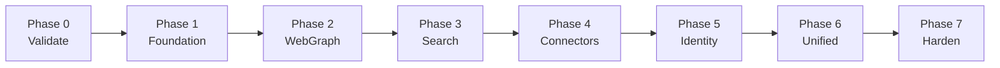

# 09 — Implementation Roadmap

**Status:** Proposed for founder review.
**Companion documents:** `00_EXECUTIVE_SUMMARY.md`, `06_DATABASE_AND_API_SPEC.md`, `08_BENCHMARK_PLAN.md`.
**Team assumption:** a small engineering team augmented by AI coding agents.

---

## 1. Guiding Constraints

- **Demonstrate value before scale.** The biggest risk is building infrastructure for billions of pages before proving that curated search is useful.
- **Every phase ships something runnable.** No phase ends with only schemas or only design.
- **Every phase has an objective acceptance gate** (see `08 §9`).
- **PostgreSQL first.** No second datastore without a measured, documented need.
- **Policy before crawling.** No crawl begins before the policy engine and audit log exist.

---

## 2. Phase Overview



| Phase | Objective | Indicative effort | Delegatable |
|---|---|---|---|
| 0 | Validate assumptions, calibrate thresholds | 1-2 weeks | partly |
| 1 | PostgreSQL foundation + source registry | 2-3 weeks | yes |
| 2 | URL discovery + polite crawler | 4-6 weeks | yes |
| 3 | Indexing + search | 3-4 weeks | yes |
| 4 | First commerce connectors | 3-4 weeks | yes |
| 5 | Identity resolution + aggregation | 3-4 weeks | yes |
| 6 | Unified search | 3-4 weeks | yes |
| 7 | Benchmarking, hardening, expansion | ongoing | partly |

---

## 3. Phase 0 — Research Validation and Architecture Decisions

**Objective:** turn this research package into approved, falsifiable decisions.

**Deliverables:**
- Founder sign-off on `10_OPEN_DECISIONS_AND_RISKS.md`.
- Calibrated benchmark thresholds from a small real-world sample.
- A written answer to: *what is the smallest useful MVP?*

**Tasks:**
- Run the synthetic benchmark harness against the current system to establish a baseline.
- Crawl 20 curated domains and measure real extraction accuracy.
- Verify access to at least one commerce source end-to-end.

**Acceptance:** every open decision has a recorded answer; baseline metrics are committed.

**Risks:** founder availability; commerce source access may fail (mitigation: start with a synthetic feed).

**Delegatable:** benchmark harness construction; curated-domain crawl measurement.

---

## 4. Phase 1 — PostgreSQL Foundation and Source Registry

**Objective:** the database exists, migrations run, and sources and permissions are managed.

**Deliverables:**
- `services/database` crate with a pooled SQLx connection.
- Migrations `0001_init_webgraph.sql`, `0002_init_commerce.sql`, `0003_init_timeseries.sql`.
- Admin API for sources and permissions.
- Audit logging on every administrative change.

**Dependencies:** none.

**Suggested crates:** `sqlx` (postgres, runtime-tokio-rustls, migrate), `tokio`, `serde`, `axum`, `tracing`.

**API endpoints:**
```
GET/POST   /api/v1/admin/sources
PATCH      /api/v1/admin/sources/{id}
GET/PUT    /api/v1/admin/sources/{id}/permissions
GET        /api/v1/admin/audit
```

**Tests:**
- Migration up/down on a clean database.
- Permission enforcement: a source without `may_crawl` cannot be enqueued.
- Audit log records every change with before/after state.

**Acceptance:** migrations apply cleanly from zero; permission denial is tested; audit entries are written.

**Risks:** schema churn later (mitigation: additive-first migrations).

**Delegatable:** entirely, given the schema in `06`.

---

## 5. Phase 2 — WebGraph URL Discovery and Crawler

**Objective:** discover URLs from curated seeds, evaluate policy, and crawl politely.

**Deliverables:**
- `webgraph-discovery`: seed registry, sitemap parser, robots.txt evaluator, link extractor.
- `webgraph-policy`: policy engine, domain policy store, takedown register.
- `webgraph-crawler`: PostgreSQL-backed queue, scheduler, fetcher with conditional requests.
- URL validation pipeline (SSRF, scheme, normalization).
- Migration of the existing crawler's useful behaviour into the new modules.

**Dependencies:** Phase 1.

**Suggested crates:** `reqwest` (with `hickory-resolver` for IP pinning), `robotstxt` (or an RFC 9309 implementation), `quick-xml`, `scraper`, `url`, `hickory-proto`, `sha2`.

**Database migrations:** none new; populates Phase 1 tables.

**API endpoints:**
```
POST /api/v1/submissions/urls
GET  /api/v1/admin/crawl/queue
POST /api/v1/admin/crawl/queue/{id}/pause
POST /api/v1/admin/crawl/domains/{domain}/policy
```

**Tests:**
- robots.txt: RFC 9309 corpus ≥ 0.99.
- SSRF: 100% rejection of internal addresses.
- Politeness: 100% budget adherence in a simulated run.
- Conditional requests: `304` produces no re-index.

**Acceptance (Gate G1):** crawl success ≥ 0.90; politeness compliance 1.00; zero SSRF bypasses.

**Risks:**
- IP blocking from aggressive crawling → strict budgets and honest User-Agent.
- Parser vulnerabilities → size caps, memory-safe crates, dependency auditing.
- Scope creep into rendering → rendering is explicitly out of scope for this phase.

**Delegatable:** discovery, policy engine, and crawler are independent modules with clear interfaces.

---

## 6. Phase 3 — Web Indexing and Search

**Objective:** turn fetched pages into a searchable index with provenance.

**Deliverables:**
- `webgraph-indexer`: extraction, fingerprinting, change detection.
- `webgraph-url-registry`: URL lifecycle state machine.
- Search over PostgreSQL FTS + pg_trgm.
- Public web search API.
- Result explanations.

**Dependencies:** Phase 2.

**Suggested crates:** `sqlx`, `unicode-segmentation`, `whatlang` (language detection), `simhash` (near-dup), `tantivy` (only if a measured need appears).

**Database migrations:** add `search_vector` generated column and FTS index.

**API endpoints:**
```
GET /api/v1/search?q=&limit=&cursor=&language=&country=
```

**Tests:**
- Extraction accuracy ≥ thresholds in `08 §2.3`.
- Change detection ≥ 0.98.
- Search p95 ≤ 800 ms on the benchmark corpus.
- Precision@10 ≥ 0.65.

**Acceptance (Gate G2):** relevance and latency thresholds met; every result carries provenance.

**Risks:**
- PostgreSQL FTS insufficient for ranking → measure first; Tantivy is the fallback.
- Language detection accuracy → report confidence, never assert certainty.

**Delegatable:** indexer and search API are separable.

---

## 7. Phase 4 — First Commerce Connectors

**Objective:** ingest real product data from at least two independent sources.

**Deliverables:**
- `commerce-ingestion` with the `Connector` trait.
- Connector 1: an official API (e.g. Best Buy) or a licensed feed.
- Connector 2: a different category (e.g. an affiliate feed or a partner catalogue).
- Ingestion run recording and alerting.
- Source permission enforcement in the write path.

**Dependencies:** Phase 1. Phases 2-3 may run in parallel.

**Suggested crates:** `reqwest`, `csv`, `quick-xml`, `serde_json`, `chrono`, `rust_decimal`.

**Database migrations:** none new.

**API endpoints:**
```
GET /api/v1/admin/sources/{id}/ingestion-runs
POST /api/v1/admin/ingestion-runs/{id}/abort
```

**Tests:**
- Connector handles malformed input without corrupting state.
- Permission denial prevents writes.
- Ingestion run records accurate counts.
- Schema drift is detected.

**Acceptance:** two connectors run on a schedule; ingestion success ≥ 0.95; provenance on every record.

**Risks:**
- Source access denied → have a synthetic connector as a fallback for testing.
- Rate limits → respect and back off.
- Terms ambiguity → legal review before enabling any connector.

**Delegatable:** each connector is an independent work package.

---

## 8. Phase 5 — Product Identity Resolution and Offer Aggregation

**Objective:** merge listings into canonical products without false merges.

**Deliverables:**
- `commerce-identity`: identifier hierarchy, matching rules, review queue.
- Offer aggregation and currency normalization.
- Price history and availability APIs.

**Dependencies:** Phase 4.

**Suggested crates:** `sqlx`, `rust_decimal`, `strsim` (similarity), `pg_trgm` via SQL.

**API endpoints:**
```
GET /api/v1/products?q=&min_price=&max_price=&brand=&merchant=
GET /api/v1/products/{id}
GET /api/v1/products/{id}/offers
GET /api/v1/products/{id}/price-history
GET /api/v1/products/{id}/availability
```

**Tests:**
- Identity precision ≥ 0.98; recall ≥ 0.90.
- Zero auto-merges without a strong identifier.
- Currency conversion correctness.
- Stale offers demoted, not removed.

**Acceptance (Gate G3):** identity thresholds met; no weak auto-merges; offer correctness ≥ 0.99.

**Risks:**
- Over-merging destroys trust → conservative thresholds and a review queue.
- Under-merging fragments results → measure recall and tune.

**Delegatable:** identity resolution and aggregation are independent.

---

## 9. Phase 6 — Unified Search

**Objective:** compose web and commerce results under one query interface.

**Deliverables:**
- Shared identity and provenance services.
- Intent classification extended for product intent.
- Unified ranking with the no-commission invariant enforced by a test.
- Result explanations.

**Dependencies:** Phases 3 and 5.

**Suggested crates:** existing gateway crates; `sqlx`.

**API endpoints:** the full set in `06 §7`.

**Tests:**
- Ranking is invariant to affiliate rate permutation (structural test).
- Commerce unavailable → web results still served.
- Every displayed fact has `may_redistribute = true`.
- Product Precision@5 ≥ 0.75.

**Acceptance (Gate G4):** unified thresholds met; graceful degradation verified.

**Risks:**
- Ranking contamination by commercial pressure → structural exclusion of commission data.
- Latency from dual-index queries → measure and cache.

**Delegatable:** ranking and explanation are separable.

---

## 10. Phase 7 — Benchmarking, Hardening, Controlled Expansion

**Objective:** prove the system holds up and expand scope deliberately.

**Deliverables:**
- Full benchmark suite in CI.
- Failure injection tests.
- Security audit.
- Legal review of all enabled sources.
- Expansion plan based on measured coverage.

**Dependencies:** Phase 6.

**Acceptance (Gate G5):** all gates green under load and failure injection.

**Risks:** complacency after launch → scheduled re-evaluation.

---

## 11. Smallest Useful MVP

**Recommended MVP boundary:**

> A curated set of ~50-200 domains, crawled politely with full policy enforcement, indexed with PostgreSQL FTS, searchable through a public API with provenance on every result, plus **one** commerce connector feeding a product search that aggregates at least two merchants for a handful of products.

**Why this is the right MVP:**
- It exercises every critical path: discovery, policy, crawl, index, search, ingestion, identity, aggregation.
- It is small enough to reason about and to crawl without being blocked.
- It produces something a user can actually try.
- It avoids the two classic traps: building a Google-scale crawler, and building a product database with no search.

**Explicitly not in the MVP:**
- Headless rendering.
- User-submitted URLs.
- More than a handful of commerce connectors.
- Open-web (non-curated) crawling.
- Mobile apps.

---

## 12. Agent Delegation Plan

| Work package | Owner agent | Depends on | Interface contract |
|---|---|---|---|
| Database foundation | Agent A | Phase 0 approval | schema in `06` |
| Discovery module | Agent B | Agent A | `DiscoveredUrl` struct |
| Policy engine | Agent C | Agent A | `Decision` enum |
| Crawler | Agent D | Agents B, C | queue table schema |
| Indexer | Agent E | Agent D | `page_revision` schema |
| Search API | Agent F | Agent E | FTS query interface |
| Connector SDK | Agent G | Agent A | `Connector` trait |
| Connector 1 | Agent H | Agent G | `RawListing` struct |
| Connector 2 | Agent I | Agent G | `RawListing` struct |
| Identity resolution | Agent J | Agents H, I | `product` schema |
| Aggregation | Agent K | Agent J | `offer` schema |
| Unified ranking | Agent L | Agents F, K | ranking config |
| Benchmark suite | Agent M | all | dataset format |

**Ownership boundaries:**
- Each agent owns one crate and its tests.
- Interfaces are defined before work starts and are not changed unilaterally.
- No agent modifies another agent's schema without a recorded decision.
- Every agent must ship a test that fails when its contract is violated.

---

## 13. Open Questions

1. **Team size and pace.** Effort estimates assume one engineer per work package; with agents, wall-clock may compress but review time does not.
2. **Founder review cadence.** How often will decisions be reviewed?
3. **Legal budget.** Source terms review is on the critical path for Phase 4.
4. **Hosting.** Where will the crawler egress live, and what is the acceptable bandwidth cost?
5. **MVP scope confirmation.** Is the recommended MVP boundary acceptable?

---

*Proposal only. Effort estimates are order-of-magnitude and must be validated in Phase 0.*
