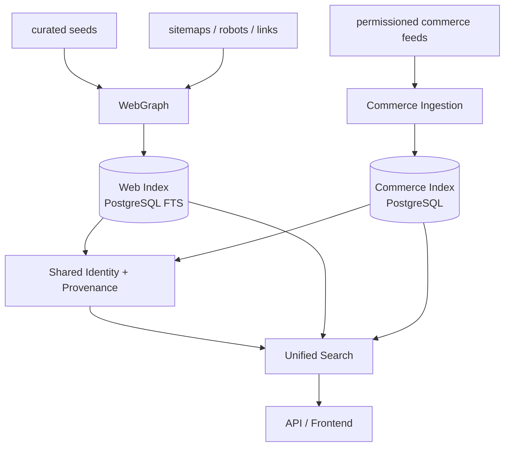

# Founder Review Page

**IntentForge — Web Discovery & Commerce Intelligence Architecture**
**Research package, 10 November 2026**

This page is the shortest path to a decision. Read it first; the twelve documents behind it carry the evidence.

---

## 1. What We Learned

### The search-engine research confirms the approach

Modern search engines separate discovery, crawling, indexing, and serving into distinct systems. Critically, **no credible independent engine attempts open-web coverage at Google scale** — they curate or partner. That validates a curated, policy-governed index for IntentForge.

### The codebase is not on the locked foundation

| Locked decision | Reality |
|---|---|
| PostgreSQL primary database | **Not used anywhere.** No SQLx dependency. |
| SQLx for data access | Not present. |
| Web discovery: controlled | The crawler has **no robots.txt, no sitemap support, no politeness delay, no conditional requests, no crawl budget**, and uses a hardcoded browser User-Agent. |

The existing crawler (1,793 lines) and indexer (905 lines, Tantivy + Sled) are real work but sit outside the agreed architecture.

### The commerce research produced the most consequential finding

> **Almost every commerce data provider forbids the exact use IntentForge assumes: building a standing product database, redistributing product data, or aggregating catalogues across merchants.**

Three verbatim clauses (full text and sources in `03_COMMERCE_DATA_RESEARCH.md`):

- **Amazon** §11(12) — prohibits redistributing Product Advertising Content or any application that displays it.
- **Shopify** §3.14 — prohibits using the API *"to build any commerce or product index"*; Catalog guidelines prohibit aggregation and rehosting.
- **eBay** §4.4 — prohibits commercializing or storing eBay Content beyond intermediate purposes.

**This is strategic, not technical.** The mission brief assumed a hybrid catalogue drawing on merchant APIs, feeds, affiliate networks, and permitted extraction. For most of those sources, the assumed use is outside the licence. The architecture must be redesigned around the *actual* permission landscape.

Three viable paths remain: **(a)** live per-request proxying with no standing index, **(b)** link-only monetisation with no product data stored, **(c)** permissioned feeds under merchant consent or partner agreement.

### There is no keyless structured-price engine

SearXNG ships two shopping engines in this build — `ebay` and `geizhals`. Both are disabled by default and both return **HTTP 403** from a datacenter/VPN egress. The gateway's existing `categories=shopping` fan-out has been silently falling back to general web results because the category was never registered.

### Security posture needs work before any crawl

The current crawler has no SSRF protection, no URL validation, no size limits, and no network isolation.

---

## 2. What We Recommend Building

**Five principles:**

1. PostgreSQL is the system of record; any inverted index is a projection.
2. WebGraph and Commerce stay separate, meeting only through shared identity and provenance at read time.
3. Policy is code — permissions are rows evaluated by a testable engine.
4. Ranking is **structurally independent of commission**, enforced by a test.
5. Curated scope, not open-web crawling.

**Recommended MVP:**

> ~50-200 curated domains crawled politely with full policy enforcement, indexed in PostgreSQL, searchable via a public API with provenance on every result — plus **one** commerce connector operating under an explicit permission, aggregating at least two merchants for a handful of products.

**Recommended first milestone (M1):** crawl **20 curated domains** with full policy enforcement, store everything in PostgreSQL with provenance, and serve an explainable public web search API.

---

## 3. What Should Not Be Built Yet

| Item | Why |
|---|---|
| Headless rendering | ~350MB-1GB RAM per browser; legal exposure; most MVP content is static |
| User-submitted URLs | Abuse vector; needs identity verification and review tooling |
| Open-web crawling | Legal exposure, crawl traps, unbounded cost |
| More than a few commerce connectors | Each requires legal review; access is unproven |
| A second search engine (Tantivy) | Adds a consistency obligation without a measured need |
| Mobile applications | API-first; clients follow demonstrated value |

---

## 4. What Could Block the Project

1. **Commerce licensing — the largest risk.** If no provider grants permission for the intended use, the commerce thesis must be redesigned around live proxying or link-only models.
2. **Legal review availability.** Decisions D6 and D7 cannot proceed without counsel.
3. **Founder review cadence.** Ten decisions need approval.
4. **Crawl egress quality.** If both VPN and Tor are blocked by target sites, coverage suffers.
5. **Team capacity.** Estimates assume parallel agent delegation; review time does not compress.

---

## 5. The 10 Most Important Decisions for Founder Approval

| # | Decision | Recommendation |
|---|---|---|
| 1 | **D1 — Crawl scope** | Curated domains (50-200 initially) |
| 2 | **D2 — Headless rendering** | Defer past the MVP |
| 3 | **D3 — Search engine** | PostgreSQL FTS first; Tantivy only on measured need |
| 4 | **D4 — Retention periods** | Short defaults with per-content-type justification |
| 5 | **D5 — User-submitted URLs** | Defer |
| 6 | **D6 — Price display from crawled pages** | Prohibit without explicit permission *(legal review required)* |
| 7 | **D7 — Commerce sourcing** | Global-first; add India as access is verified |
| 8 | **D8 — Revenue model** | Affiliate-first with structural ranking independence |
| 9 | **D10 — Query log retention** | 90 days, salted hashes by default |
| 10 | **D11 — Takedown SLA** | 24 hours for suppression |

Full reasoning, alternatives considered, and consequences are in `10_OPEN_DECISIONS_AND_RISKS.md`.

---

## 6. Recommended First Implementation Milestone

**Milestone M1 — end of Phase 1 + first half of Phase 2**

> A running system that crawls **20 curated domains** politely with full policy enforcement, stores everything in PostgreSQL with provenance, and serves a public web search API whose results are explainable.

**Acceptance criteria:**

| Criterion | Threshold |
|---|---|
| Crawl success rate | ≥ 0.90 |
| Politeness compliance | 1.00 |
| SSRF bypasses | 0 |
| Search p95 latency | ≤ 800 ms |
| Provenance on results | 100% |

**Why this first:** it proves the entire critical path without commerce complexity, generates the real-world data needed to calibrate benchmarks, and gives the founder something usable to evaluate before the harder commerce questions are settled.

---

## 7. How to Challenge This Package

The package is designed to be falsifiable. The weakest points, stated plainly:

1. **D3 (PostgreSQL FTS)** is a proposal, not a measurement. It must be validated in Phase 0 against a real query set.
2. **Benchmark thresholds** in `08` are initial proposals and must be calibrated against real data.
3. **Effort estimates** in `09` are order-of-magnitude.
4. **Legal statements** in `07` are a framework for counsel, not legal advice.
5. **Commerce architecture** in `04` assumes at least one permissioned source becomes available. If none does, that document needs redesign.

---

## 8. Package Contents

| Document | Purpose |
|---|---|
| `00_EXECUTIVE_SUMMARY.md` | Findings, architecture, decisions, risks, MVP |
| `01_SEARCH_ENGINE_RESEARCH.md` | Google, Bing, DuckDuckGo, Brave — evidence-based |
| `02_WEBGRAPH_ARCHITECTURE.md` | Complete WebGraph design |
| `03_COMMERCE_DATA_RESEARCH.md` | Provider-by-provider evidence and clauses |
| `04_COMMERCE_ARCHITECTURE.md` | Canonical catalogue, identity, provenance |
| `05_UNIFIED_SEARCH_ARCHITECTURE.md` | Query understanding, ranking, explanations |
| `06_DATABASE_AND_API_SPEC.md` | ER diagram, schema, migrations, API contracts |
| `07_SECURITY_PRIVACY_AND_COMPLIANCE.md` | Threat model, legality, privacy |
| `08_BENCHMARK_PLAN.md` | Metrics, datasets, thresholds |
| `09_IMPLEMENTATION_ROADMAP.md` | Phases, dependencies, agent work packages |
| `10_OPEN_DECISIONS_AND_RISKS.md` | Decision and risk registers |
| `SOURCES.md` | 203 cited sources with URLs and access dates |

**Evidence convention:** **[CONFIRMED]** = primary source states it · **[INFERRED]** = well-supported engineering reasoning · **[UNKNOWN]** = undisclosed or unverified.

---

*This page is a proposal. Nothing in this package is approved architecture until the founder signs off on the decisions in `10_OPEN_DECISIONS_AND_RISKS.md`.*
